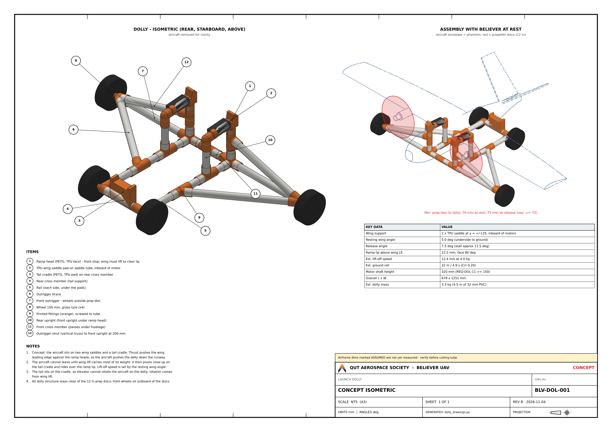

# Launch Dolly - Wing-Saddle Concept Model

| | |
|---|---|
| **Drawings** | BLV-DOL-001, Rev B (concept) |
| **Date** | 2026-11-04 |
| **Status** | Concept - airframe dimensions marked ASSUMED are not yet measured |

Parametric CAD model, checks and drawing set for a wing-saddle launch dolly for the Believer, against `docs/engineering/requirements/launch-dolly-requirements.md`. Every view, dimension, cut length and clearance in the drawing set is generated from the parameters in `dolly_model.py`; change a parameter and re-run to regenerate the set.

## Files

| File | Content |
|---|---|
| `dolly_model.py` | Parameters, Believer envelope, dolly frame (nodes and members), printed parts, cut list |
| `dolly_analysis.py` | Clearance checks, separation sweep, launch and ramp calculations |
| `dolly_drawings.py` | Hidden-line projections, A3 drawing sheets, STEP/STL and JSON export |
| `out/BLV-DOL-001-launch-dolly-concept.pdf`, `out/BLV-DOL-001.png` | Concept isometric sheet (A3) |
| `out/believer-dolly-assembly.step` | Dolly assembly solid model |
| `out/believer-envelope-at-rest.step` | Simplified aircraft envelope in the rest position on the dolly |
| `out/printed-*.step`, `out/printed-*.stl` | Ramp head, saddle pad and tail cradle |

To regenerate: `pip install cadquery scipy matplotlib`, then `python dolly_drawings.py` (sheet 1 only). With the environment variable `ALL_SHEETS=1` set, the script also generates the GA, three-view, launch-geometry and cut-list sheets (BLV-DOL-002 to 005) and `out/dolly-results.json`; these are not current at Rev B.

## Concept

- The wing rests on two TPU saddle pads at $y = \pm 125$ mm, inboard of the motors. Each pad sits on a 32 mm PVC saddle tube on two uprights.
- A 3D-printed ramp head stands at each pad, just ahead of the wing leading edge. Thrust pushes the leading edge into the ramp face, so the aircraft pushes the dolly down the runway.
- The rear fuselage rests on a printed tail cradle clamped to the rear cross member.
- The base frame is two rails plus front and rear cross members. Front outriggers carry the front wheels outboard of the propeller discs, and the rear wheels sit on the rear corners.
- Each outrigger has two braces: a horizontal brace back to the rail, and a vertical strut from the outrigger end up to a tee on the front upright at 200 mm. Together they form a truss in each plane, so vertical wheel loads are not carried by the outrigger tube in bending alone. The strut is 94 mm from the nearest propeller disc.
- Joints are printed PETG fittings, screwed to the tube.

### How the aircraft leaves the dolly

The tail rests on the cradle, so elevator input cannot pitch the aircraft up while it is on the dolly. A nose-up command only pushes the tail harder into the cradle. Rotation comes from wing lift. The aircraft pivots about the tail-cradle contact once the lift moment about that point exceeds the weight moment:

$$L\,(x_T - x_{ac}) \ge W\,(x_T - x_{cg})$$

With the CG at about 25% MAC, which is also the approximate aerodynamic centre, this reduces to $L \approx W$. The wing therefore stays at its resting angle until the speed at which that angle supports the weight:

$$V_{LO} = \sqrt{\frac{2W}{\rho S\,(C_{L0} + C_{L\alpha}\,\alpha_{rest})}}$$

With $C_{L0} = 0.257$ and $C_{L\alpha} = 0.1122$/deg (Weishaupl et al. 2024), a 4.0 kg mass and a 5.0 deg resting angle, $V_{LO} = 12.4$ m/s. This is inside the 11-13 m/s release target in SRD Section 3b. The resting wing angle is the main design lever for lift-off speed (BLV-DOL-004 chart). Its datum relative to the $\alpha$ reference of the drag-polar data is TBD.

### Ramp lip

The lip height equals the rise of the leading edge when the aircraft pivots about the tail contact from $\alpha_{rest} = 5.0$ deg to $\alpha_{rel} = 7.5$ deg. The model solves this as 22.5 mm. The release angle sits about 4 deg below the estimated stall angle of 11.5 deg.

### Ramp face angle

Neglecting friction, the aircraft can start to climb the ramp face once

$$L + F_{ramp}\cot\theta \ge W, \qquad F_{ramp} = m_d\,a + C_{rr}\left(m_d g + W - L\right)$$

Here $F_{ramp}$ is the force the leading edge transmits to accelerate the dolly and overcome its rolling resistance. With $\theta = 80$ deg, this first happens at 12.0 m/s, with lift at 94% of weight. Friction on the face raises this threshold. As the leading edge rides up the face, the aircraft pivots nose-up on the tail cradle, so lift exceeds weight by the time the leading edge reaches the lip.

| Face angle $\theta$ (deg) | Speed at which ramp climb starts (m/s) | Lift / weight at that point |
|---|---|---|
| 60 | 11.0 | 0.78 |
| 70 | 11.6 | 0.87 |
| 80 | 12.0 | 0.94 |
| 85 | 12.2 | 0.97 |

## Check Results

| Check | Result | Required |
|---|---|---|
| Propeller disc to dolly, at rest (3D) | 79 mm | >= 75 mm |
| Propeller disc to dolly, at release (3D) | 75 mm | >= 75 mm |
| Motor shaft above ground (REQ-DOL-11) | 320 mm | >= 150 mm |
| Belly over base frame | 61 mm | >= 40 mm |
| Fuselage side to pad / ramp head | 24 mm | >= 20 mm |
| Separation path, minimum gap (1:4 relative climb, after 50 mm travel) | 8 mm | > 0 |
| Dolly pitch-over margin under ramp push | 1.37 | > 1.0 |
| Wing-tip strike roll angle at rest | 16.5 deg | - |
| Estimated ground roll (Crr 0.20) | 32 m / 4.9 s | - |
| Estimated dolly mass | 3.3 kg | - |

Clearances are minimum distances between the OpenCascade solids. Distances reported near zero are cross-checked for interference volume and re-measured on dense surface samples.

The separation sweep places the aircraft at the release attitude, then moves it ahead of the dolly while it rises 1 mm per 4 mm of travel. This rate is slower than the roughly 1:1 rate estimated from 1.3 g of lift at release against the decelerating dolly.

The narrowest point is the wing passing over the ramp lip in the first 50 mm of travel.

## Assumed Parameters - Measure Before Build

| Parameter | Value | Measurement |
|---|---|---|
| `motor_y` | 330 mm | Motor spanwise station from centreline (sets the outrigger width and prop clearance) |
| `prop_ahead_LE` | 110 mm | Propeller plane ahead of the wing leading edge |
| `c_root` / `c_tip` | 300 / 220 mm | Chord at the root and tip; wing underside profile at the pad station |
| `LE_from_nose` | 330 mm | Wing leading edge aft of the nose |
| `wing_above_belly` | 150 mm | Wing underside above the belly at the root |
| `fus_width` | 160 mm | Fuselage width at the wing |
| `tail_contact_from_nose` | 860 mm | Tail cradle contact station; belly profile there |
| `T_drop_per_ms` | 0.8 N per m/s | Thrust fall-off with speed |
| `Crr` | 0.20 | Rolling resistance on the field grass |
| `tube_kg_per_m`, `fitting_kg`, `wheel_kg` | 0.30 / 0.045 / 0.25 kg | Weigh samples |

The tightest margins are the propeller clearance to the ramp heads and the gap between the fuselage side and the pads. Both depend on `motor_y`, `prop_ahead_LE` and `fus_width`.

## Tube and Fittings

32 mm OD PVC conduit, 4.45 m in total (buy 5.5 m). Setting `tube_od = 25` and re-running regenerates the cut list, fittings and clearances for 25 mm tube. Printed fittings are PETG, and the pads, ramp faces and cradle top are TPU 95A. The wheels are 150 mm grass-capable wheels on M8 axle bolts.
