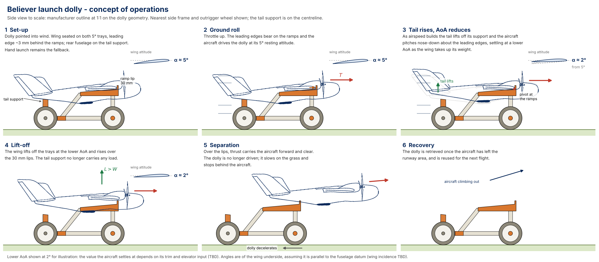
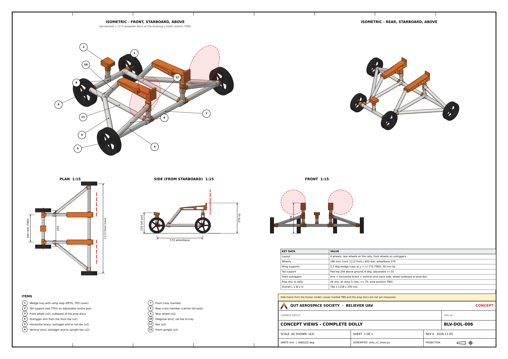
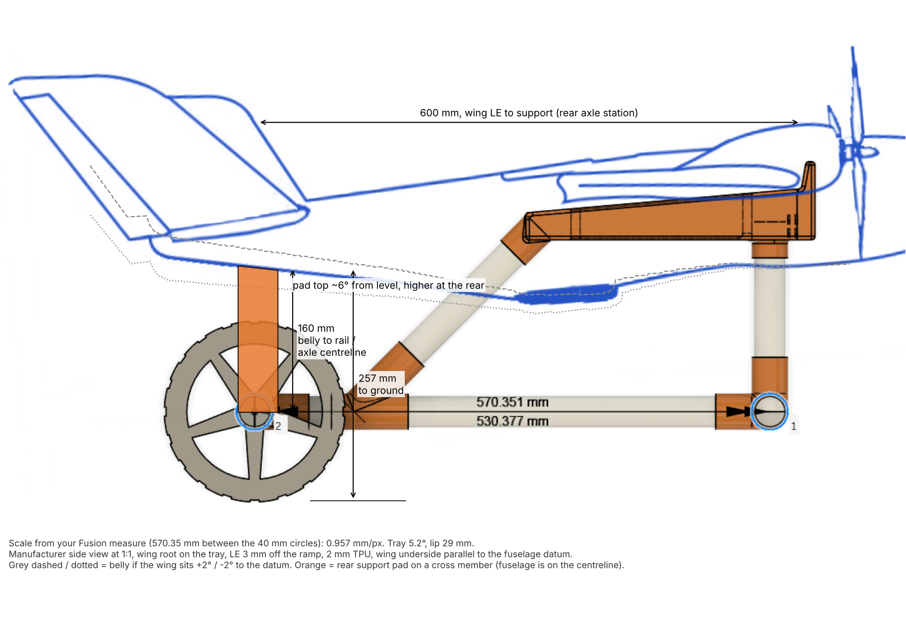

# Launch Dolly - System Requirements

| | |
|---|---|
| **Document** | SRD-BELIEVER-DOLLY-001 |
| **Revision** | 0.6 |
| **Date** | 2026-11-05 |
| **Status** | Draft |

## 1. Scope

This document defines the requirements for a launch dolly: a temporary, releasable ground-roll cart that supports the Believer during takeoff acceleration and separates from the aircraft at or before rotation. It does not cover permanent landing gear (the airframe has none - see Section 3a) or the existing assisted hand-launch procedure, which remains available as a fallback (see Section 2).

**This is an interim solution for the current Believer airframe.** A custom-designed replacement airframe is in early requirements development and will include its own landing gear (`docs/engineering/requirements/custom-airframe-requirements.md` REQ-AF-50), which is expected to make the launch dolly obsolete once built. The dolly remains in active use/development for the current airframe in the meantime.

## 2. Purpose and Concept of Operations

Believer currently departs exclusively via a two-person assisted hand launch (`docs/operations/manual.md`, Assisted Hand Launch section): a handler holds the aircraft at shoulder height and throws it forward into wind on the pilot's call, at 75-100% throttle. This works, but if anything goes wrong during the throw (mistimed release, a stumble, an incorrect launch attitude or speed), the aircraft is more exposed to damage than it would be accelerating to flying speed under its own power and rotating off a ground roll, the way a wheeled aircraft departs.

A launch dolly gives the aircraft that powered ground roll before departure, the way a fixed-wing aircraft without permanent landing gear is conventionally launched: the aircraft rests on the dolly and drives it down the field under its own thrust, lifts off once the wing is carrying its weight, and leaves the dolly behind - after which the dolly is retrieved and reused for the next flight. The launch concept and sequence are defined in Section 3c. This is standard practice for foam/composite airframes (Believer's case) that don't carry permanent gear for weight reasons.

The dolly is intended to reduce the aircraft's exposure to hand-launch failure modes - it is not necessarily a mandatory replacement for hand launch, which remains available as a fallback (e.g. if the dolly is unavailable or the site is unsuitable for a ground roll).

**Target operating surface:** standard grass runways, with some level of unevenness expected and tolerated (per user confirmation) - see REQ-DOL-13/14.

## 3. Reference Documents

- `docs/operations/manual.md` - current assisted hand-launch procedure, pre-flight checklist
- `docs/engineering/ICD.md` - motor/propeller clearance data
- `docs/governance/timeline-and-roadmap.md` - launch dolly future-capability roadmap entry this document expands
- `docs/operations/manual.md` - airspeed parameters referenced in Section 3b
- `AI-context/open-items.md` - open dependencies against this subsystem
- `docs/engineering/analysis/launch-dolly-concept/` - dolly concept model, launch calculations and the tail-support fit in Section 3c

## 3a. Airframe Reference Data (Reference Only)

Recorded here as sizing reference data - none of it is itself a requirement.

| Property | Value |
|---|---|
| Wingspan | 1960mm |
| Fuselage length | 1070mm |
| Fuselage height | 185mm |
| Wing area | 51dm² |
| Maximum take-off weight (MTOW) | 5.5kg |
| Landing gear | None fitted - the airframe lands belly-down (`docs/engineering/requirements/underslung-camera-mount-requirements.md` REQ-CAM-13) |
| Motor-shaft-to-ground clearance (current, no gear) | 150mm - constrains propeller diameter to 11" (`docs/engineering/ICD.md`) |
| CG | 15mm aft of the front wing spar centreline, ~25% MAC |

Per the manufacturer's published wingspan/wing-area figures, wing loading at MTOW is approximately 5.5kg / 0.51m² ≈ **10.8 kg/m²**; at the aircraft's current actual flying weight with no payload fitted (4.0kg, the maiden flight's `WEIGHT_GROSS`), it is about **7.8 kg/m²** - the more relevant figure until a payload is added.

## 3b. Airspeed Reference Data (Reference Only)

As-configured PX4 parameters (`docs/operations/backups/Pixhawk Parameter Backup/believer-parameters.params`), current as of the 2026-10-11 maiden flight:

| Parameter | Value | Relevance |
|---|---|---|
| `FW_AIRSPD_STALL` | 11 m/s | PX4's configured stall estimate - absolute floor, no margin |
| `FW_AIRSPD_MIN` | 15 m/s | Floor PX4 itself will command in autonomous modes |
| `FW_AIRSPD_TRIM` | 20 m/s | Cruise target - well above what a ground roll needs to achieve |
| `FW_AIRSPD_MAX` | 28 m/s | Upper airspeed limit |

**Measured stall speed (2026-10-11 maiden flight, Phase G):** three repeated deliberate stall breaks (full-aft-stick, stick neutral, nose dropping on its own) landed at **8.15, 9.95, and 8.66 m/s indicated airspeed**, at the aircraft's actual flying weight that day (4.0kg) - see `docs/engineering/test-reports/2026-10-11-maiden-flight.md`. This is a real measured floor, not a parameter estimate, and is somewhat lower than the configured `FW_AIRSPD_STALL` above. A release speed with a standard ~1.15-1.3x margin above this measured range works out to roughly **11-13 m/s** - see Section 6.

Using the Weishäupl et al. 2024 drag-polar reference data (`CL0` = 0.2570, `CLα` = 0.1122/deg - for what is very likely the same commercial airframe, `docs/engineering/references/weishaupl-et-al-2024-drag-curves-small-fixed-wing-uavs.pdf`, extracted in `AI-context/project-notes.md`) against the 4.0kg flying weight and 0.51m² wing area, the wing AoA needed to generate exactly enough lift at 11-13 m/s works out to roughly **5-6°** - this is the target wing AoA at separation. On the dolly the wing-support angle sets the resting attitude, and the aircraft pitches down from it to a lower AoA before lift-off (Section 3c); the relationship between the physical wing-underside angle and the AoA reference of the drag-polar data is TBD (Section 6).

## 3c. Launch Concept (Decided)

**Decided:** a wing-saddle dolly with ramp stops. The aircraft rests on the underside of its wing on two wing supports, one each side inboard of the motors, and on a tail support under the rear fuselage. Thrust is transmitted to the dolly through the wing leading edges bearing on a ramp at the front of each wing support, so the aircraft drives the dolly down the runway. As airspeed builds, the tail lifts off its support and the aircraft pitches nose-down about the leading edges to a lower AoA; it then lifts its wing off the supports and over the ramp lips.

### Configuration

| Item | Description |
|---|---|
| Base frame | Two side frames, one under each wing, each built on a lower rail of PVC tube with 3D-printed fittings, joined by front and rear cross members. Rail centres about 340 mm apart (TBD) |
| Wing supports | One per side: a 3D-printed wedge tray with lightening cutouts and a TPU cover, carried on a front upright and a diagonal strut from a rail tee. Tray surface 5° nose-up relative to the rail |
| Ramp stops | Integral with the front of each tray. Face 75° to the tray (80° to the ground); lip 30 mm above the tray surface. At rest the wing leading edge sits about 3 mm behind the face |
| Tail support | Centreline pad on an adjustable post on the rear cross member, at the rear axle station about 600 mm aft of the wing leading edge. TPU-faced |
| Rear wheels | One at the rear end of each rail, about 200 mm diameter; rear axle 570 mm aft of the front cross member |
| Front wheels | One each side on an outrigger from the front corner tee, outboard of the propeller disc (front track about 1110 mm, TBD). Each outrigger is braced by a horizontal brace back to the rail tee and a vertical strut up to a tee on the front upright |

### Tail-support height

Estimated by resting the manufacturer's side view at 1:1 on the wing supports, with the wing underside parallel to the fuselage datum (the side-view fit in `docs/engineering/analysis/launch-dolly-concept/rear-support-fit/`):

| Tail-support station, aft of wing LE | Belly above rail top | Belly above ground | Belly slope (higher at rear) |
|---|---|---|---|
| 450 mm | 125 mm | 240 mm | about 7° |
| 500 mm | 131 mm | 245 mm | about 7° |
| 550 mm | 136 mm | 251 mm | about 6° |
| **600 mm (rear axle station)** | **142 mm** | **257 mm** | **about 6°** |

At the rear axle station the pad top is therefore about 142 mm above the rail top (160 mm above the rail and axle centreline), inclined about 6° higher at the rear. Each 1° difference between the wing underside and the fuselage datum moves this height by about 10 mm (wing incidence TBD, Section 6), so the pad is adjustable over at least ±20 mm and is set on the aircraft: wing seated on both trays, belly just bearing on the pad without lifting the leading edges.

### Launch Sequence

1. **Set-up.** The dolly is pointed into wind. The aircraft is placed with both wing roots seated on the trays, the leading edges about 3 mm behind the ramp faces, and the rear fuselage on the tail support. The wing rests at the 5° tray angle.
2. **Ground roll.** Throttle is advanced. The leading edges bear on the ramp faces and the aircraft drives the dolly at its resting attitude. Directional control during the roll is TBD (Section 5).
3. **Tail rise.** As airspeed builds, the tail lifts off its support and the aircraft pitches nose-down about the leading edges at the ramps, settling at a lower AoA as the wing takes up its weight. The AoA it settles at depends on trim and elevator input (TBD, Section 6); the trays stop it pitching above the 5° resting angle.
4. **Lift-off.** At the lower AoA the wing lifts off the trays and rises over the ramp lips, which are about 28 mm above the wing contact on the 2 mm TPU cover. The tail support carries no load from this point.
5. **Separation.** Once the leading edges are over the lips, thrust carries the aircraft forward and clear. The dolly, no longer driven, decelerates on rolling resistance and stops behind the aircraft. Clearance along the separation path for the final geometry is TBD (Section 6).
6. **Recovery.** The dolly is retrieved once the aircraft has left the runway area.

The AoA the aircraft settles at during the tail rise sets the lift-off speed. Using the Section 3b lift data at 4.0 kg, lift-off is about 12.4 m/s at 5°, 14.5 m/s at 3° and 16 m/s at 2°; the 11-13 m/s target in Section 3b corresponds to about 4.5-6.5°.

## 4. Requirements

### 4.1 Functional

| ID | Requirement |
|---|---|
| REQ-DOL-01 | The dolly shall support the aircraft in a stable attitude throughout the ground-roll acceleration, without inducing porpoising, yaw wander, or a tendency to nose over. |
| REQ-DOL-02 | The dolly shall separate cleanly from the aircraft at or before rotation, without contacting the airframe, propellers, or control surfaces during or after separation. |
| REQ-DOL-03 | The dolly shall require no permanent modification to the airframe (no added mass, no attachment hardware left on the aircraft after separation). |

### 4.2 Physical and Structural

| ID | Requirement |
|---|---|
| REQ-DOL-10 | The dolly's wing supports shall bear only on the wing underside inboard of the motors, and its tail support only on the fuselage belly, clear of the pitot tube, GPS antennas, control surfaces and any underslung equipment (e.g. the future camera mount, `docs/engineering/requirements/underslung-camera-mount-requirements.md`). Exact contact geometry is an open item (Section 6). |
| REQ-DOL-11 | The dolly shall maintain propeller ground clearance at least equal to the current no-gear reference (150mm motor-shaft-to-ground, Section 3a) throughout the ground roll, accounting for any pitch/squat under acceleration. |
| REQ-DOL-12 | The dolly and its wheels/axles shall be rated for the aircraft's MTOW (5.5kg, Section 3a) plus dynamic loading from an uneven grass surface. |
| REQ-DOL-13 | Wheels shall be sized and tyred for standard grass runway use (not paved-only hard-wheel castors). |
| REQ-DOL-14 | The dolly shall tolerate the unevenness typical of a standard grass runway (ruts, tussocks, minor undulation) without losing directional control, inducing premature separation from the aircraft, or damaging the aircraft. Exact bump/undulation magnitude not yet quantified - see Open Items. |

### 4.3 Environmental

| ID | Requirement |
|---|---|
| REQ-DOL-20 | The dolly shall operate reliably on standard grass runway surfaces at the project's flying sites (BNEMAC, TMAC), including some unevenness (REQ-DOL-14). |

### 4.4 Interface

| ID | Requirement |
|---|---|
| REQ-DOL-30 | The dolly shall be usable alongside the existing assisted hand launch (`docs/operations/manual.md`), which remains available as a fallback - not necessarily a mandatory replacement for it. |
| REQ-DOL-31 | Use of the dolly shall not require any change to the aircraft's current pre-flight configuration or PX4 parameters beyond what a normal hand-launch pre-flight already requires. |

### 4.5 Maintainability and Operations

| ID | Requirement |
|---|---|
| REQ-DOL-40 | The dolly shall be recoverable and reusable after each launch, without requiring repair or replacement under normal use. |
| REQ-DOL-41 | The dolly shall be man-portable by a single person and stow within the project's existing ground-equipment transport. |

## 5. Requirements Not Yet Written

The following are known to matter but aren't specified yet, pending the open items in Section 6:

- Final tail-support height and pad shape (estimated in Section 3c, set on the aircraft).
- Target AoA during the tail rise (trim and elevator input), which sets the lift-off speed (Section 3c).
- Runway/steering behaviour - whether the dolly is free-rolling (aircraft controls direction via rudder/differential thrust, as is conventional) or constrained (e.g. a rail or track).

## 6. Open Items

- Believer's wing incidence relative to the fuselage datum, and the relationship between the wing-underside angle on the trays and the AoA reference of the drag-polar data - not measured. Sets the lift-off speed for a given tray angle and shifts the tail-support height by about 10 mm per degree (Section 3c).
- Tail-support final height - estimated at 142 mm above the rail top at the rear axle station (Section 3c); to be set on the aircraft.
- Fuselage belly profile at the tail-support station - not measured; needed for the pad shape.
- Rail spacing and front outrigger geometry (track, strut height) - concept values in Section 3c, to confirm in the Fusion model.
- Propeller disc clearance to the trays, ramps and outriggers - with the propeller position scaled from the manufacturer drawing (motor station about 293 mm, propeller plane about 60 mm ahead of the wing leading edge), the ramp lips sit about 44 mm behind the discs, against the 75 mm used for the concept model. Depends on the motor spanwise station and propeller plane position, neither measured.
- Clearance along the separation path over the ramp lips for the final geometry - TBD.
- Quantified unevenness the dolly must tolerate (REQ-DOL-14) - "some level of unevenness" confirmed qualitatively, but no bump height/frequency spec yet.
- Whether the dolly needs to handle crosswind/directional stability during the roll, or is intended for calm/near-headwind conditions only.

Tracked in [AI-context/open-items.md](../../../AI-context/open-items.md).

## 7. Revision History

| Rev | Date | Description |
|---|---|---|
| 0.1 | 2026-07-17 | Initial draft |
| 0.2 | 2026-07-17 | Resolved the driving motivation (Section 2) per user confirmation - reduces the aircraft's exposure to hand-launch failure-mode damage, not necessarily a mandatory replacement; resolved target surface as standard grass runways with some unevenness (REQ-DOL-13, new REQ-DOL-14, REQ-DOL-20) |
| 0.3 | 2026-08-20 | Noted (Section 1) that this dolly is an interim solution for the current Believer airframe, expected to be made obsolete by the landing gear on the new custom-designed replacement airframe once built (`docs/engineering/requirements/custom-airframe-requirements.md`) |
| 0.4 | 2026-10-12 | Replaced Section 3b's stale, pre-flight PX4 airspeed parameters with the current configured values and the maiden flight's own measured stall speed (8-10 m/s at the aircraft's actual 4.0kg flying weight, `docs/engineering/test-reports/2026-10-11-maiden-flight.md`) - a real measured floor rather than a parameter estimate. Added the current-weight wing loading figure alongside the MTOW one. Narrowed Section 6's release-speed open item to a target range (roughly 11-13 m/s) pending the dolly's release AoA |
| 0.5 | 2026-10-12 | Decided the retention/release mechanism (new Section 3c): a tail-rising dolly (sailplane/motorglider trolley style) with a single cradle 30mm forward of the CG and a separate tail support, rather than a rigid fixed-angle cradle. Added the lift-curve-derived ~5-6° separation AoA target. Distinguished the static resting angle (doesn't need precision) from the separation AoA (does). Updated Sections 5/6 accordingly; added the undocumented wing-incidence-angle gap as a new open item |
| 0.6 | 2026-11-05 | Replaced the single-cradle concept (Section 3c) with the wing-saddle dolly with ramp stops, keeping the tail rise: configuration including braced front outrigger wheels, concept-of-operations and concept-view images, tail-support height estimate, and launch sequence (tail rises and the aircraft pitches down to a lower AoA before lifting over the ramp lips). Updated Section 2, Section 3b's separation-AoA note, REQ-DOL-10 and Sections 5 and 6 to match |
