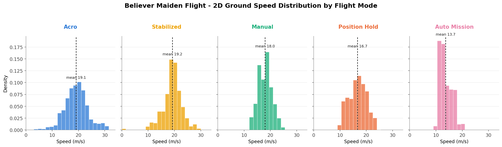
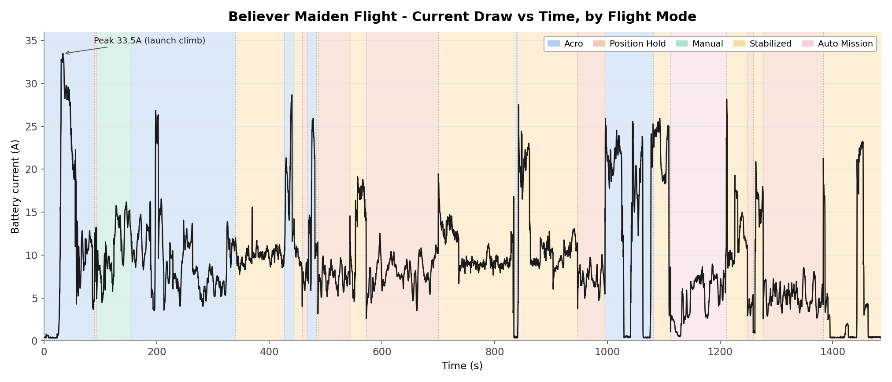

# Test Report - Maiden Flight

| | |
|---|---|
| **Date** | 2026-10-11, approximately 09:02-09:27 Brisbane local time (23:02-23:27 UTC on 2026-10-10 by the aircraft's own clock) |
| **Location** | BNEMAC field, 420 Roghan Rd, Fitzgibbon QLD 4018 |
| **Attendees** | Julian Williams (handler/ground station), Ross Dennington (BNEMAC - pilot), Henry Thomasson (ground support and videographer) |
| **Purpose** | Execute `docs/engineering/test-plans/2026-10-11-maiden-flight-test-plan.md` - first flight of the airframe |
| **Status** | Flown, complete. No crash or structural incident. Analysis traced from the Pixhawk's onboard SD card logs, the launch video, and post-flight debrief (relaying pilot Ross Dennington's account) |

Unless stated otherwise, t = 0 throughout this report is arming (t = 0.11s by the log's own `commander` message). The Launch section uses a separate reference, time since release, noted there.

## Summary

On 11 October 2026, the Believer completed its maiden flight at the BNEMAC field. The aircraft was armed for 24 minutes 47 seconds, airborne from takeoff (t = 32.6s) to landing (t = 1482.5s, disarmed t = 1486.0s), and completed most of the planned test-plan phases before landing successfully following an aborted first approach.

The hand launch left little margin above stall and is not recommended for future flights. Flight-log analysis confirmed the pilot's report of reduced roll response to the right relative to the left; common-direction propeller torque is a plausible but unconfirmed contributor. Post-flight inspection found a defective bearing in the right motor.

The RFD900x telemetry link dropped 18 times, three exceeding the 10s data-link-loss timeout. `NAV_DLL_ACT` had been set to 0 (Disabled) before the flight, so none of these triggered an automatic Return-to-Launch; this is a documented configuration decision, not a fully closed issue, since it also removes PX4's automatic response to a genuine telemetry failure. Separately, PX4's airspeed validator rejected the differential-pressure sensor 16.4s after takeoff and did not revalidate it in flight, despite the raw sensor continuing to produce plausible readings throughout - sensor accuracy itself has not been independently confirmed.

In-flight PID auto-tuning succeeded on its second attempt; rate-tracking error was lower in the post-tune segments sampled.

Required follow-up actions concern launch method, roll authority, motor condition, airspeed-sensor verification, and the still-unresolved telemetry dropout cause - see *Outstanding*.

## Findings

### Flight mode timeline (`vehicle_status.nav_state`, real flight only)

| t (s) | Mode | Likely test-plan phase |
|---|---|---|
| 0.0 | Acro | Armed (GR1 left in the Acro position from a previous check) |
| 32.6 | - | Takeoff detected |
| 89.3 | Position Hold (Loiter) | |
| 93.3 | Manual | Phase A (Airworthiness) |
| 154.5 | Acro | Phase A / H |
| 339.2 | Stabilized | Phase B |
| 426.3-486.1 | Acro / Stabilized / Position Hold, alternating | Phases A/B/H |
| 543.0-699.7 | Stabilized -> Position Hold (569.7-699.7, including the first auto-tune attempt) | Phase D (attempt 1, aborted), Phase I |
| 699.7-947.1 | Stabilized (long segment, 138s) -> Acro -> Stabilized -> Position Hold | Includes Phase E (Cruise Sweep), F (Glide), G (Stall) |
| 995.8-1081.3 | Acro -> Stabilized | |
| 1112.0-1211.1 | **Auto Mission** | Phase K (Mission Mode) |
| 1211.1-1383.4 | Stabilized / Position Hold, alternating, including the second (successful) auto-tune attempt at t=1309.3-1330.2s | Phase D (attempt 2, succeeded) |
| 1482.5 | - | Landing detected |
| 1486.0 | - | Disarmed by RC switch |

`nav_state` alone cannot separate test-plan phases that were flown within the same flight mode (e.g. Phases E/F/G all fall within the long Stabilized segment at 699.7-947.1s); phase labels above are inferred from timing and are not exact. Phase J (Return to Home via CH10) was not exercised and remains untested.

### Launch

The aircraft was hand-launched from a hill at the BNEMAC field, using nearly all of the available elevation to reach flying speed.

[Launch video](../../assets/flight-footage/maiden-flight-launch-2026-10-11.mp4) | [Launch, ground view](../../assets/flight-footage/maiden-flight-launch-ground-view-2026-10-11.mp4)

Time in this section is measured from the moment altitude first leaves the ground (release), not from arming as elsewhere in this report. After release, the aircraft descended 3.3m below launch height before establishing a sustained climb approximately 4s later, with a second, shallower sag (~1.8m) around t=3.5s.

The lowest point coincided with the lowest airspeed of the window, 12.4 m/s true airspeed - only 1.4 m/s above `FW_AIRSPD_STALL` (11 m/s, defined in calibrated airspeed; true airspeed exceeds calibrated airspeed by under 0.3 m/s at this altitude and speed, not enough to change the conclusion). This window falls entirely within the period the airspeed validator still trusted the sensor (see *Airspeed System Assessment*), so the figure is EKF-fused, not a ground-speed proxy.

**Decision:** future flights will use a launch dolly instead of a hand launch - see `docs/engineering/requirements/launch-dolly-requirements.md`, tracked in `AI-context/open-items.md`.

### Climb and Altitude Performance

Between takeoff (t=32.6s) and the Acro-to-Position-Hold transition (t≈89.3s), the aircraft gained approximately 59m of altitude - a net average climb rate of 1.0 m/s. This figure is not representative of sustained climb capability: the segment was flown in Acro mode with substantial manoeuvring rather than a continuous climb, comprising approximately 140m of cumulative ascent and 81m of descent (mean rate 4.26 m/s during ascending portions).

A cleaner sustained climb later in the flight, in Stabilized mode at approximately 91% throttle and 19-20 m/s ground speed, reached 5.6 m/s over 6-10s (peak 6.5 m/s) - a more representative, though not exhaustive, indication of climb capability. A dedicated, controlled climb test would be needed to establish the maximum sustained rate.

Altitude-holding performance was good in both autonomous modes:

- **Position Hold:** RMS altitude tracking error of 1.1-1.6m across four segments totalling approximately 340s, maximum transient deviation 4.5m, maintained through both in-flight auto-tune attempts.
- **Mission mode:** RMS error of 1.26m once established on the commanded path, comparable to Position Hold. The aircraft took 28.6s after engagement to converge within 2m of the commanded altitude, reflecting the time needed to descend from its initial altitude to the new setpoint, not a tracking deficiency.

Maximum altitude recorded was 112.6m AGL (137.3m AMSL), below the configured 120m AGL geofence limit (`GF_MAX_VER_DIST`).

### Speed Performance

Ground speed (2D, `vehicle_local_position` vx/vy) averaged 18.1 m/s in flight, with a maximum of 31.3 m/s; the average across the full recording, including ground operations, was 17.7 m/s. This is used in place of airspeed, since `airspeed_validated` - not the raw sensor, confirmed healthy throughout (see *Airspeed System Assessment*) - was invalid for nearly the whole flight. Ground speed includes wind effects, unlike airspeed.

Ground speed varied between flight modes, as summarised below.

| **Flight mode** | **Mean (m/s)** | **95th percentile (m/s)** | **Maximum (m/s)** |
| --------------- | -------------- | ------------------------- | ----------------- |
| Acro            | 19.1           | 27.3                      | 31.3              |
| Stabilized      | 19.2           | 24.5                      | 28.8              |
| Manual          | 18.0           | 22.3                      | 24.3              |
| Position Hold   | 16.7           | 22.1                      | 24.1              |
| Auto Mission    | 13.7           | 17.7                      | 20.7              |

Auto Mission exhibited the lowest and most consistent ground speeds (13.7 m/s mean), with the tightest distribution - consistent with TECS holding a steady cruise through the mission pattern's repeated turns (`NAV_LOITER_RAD` = 50m). Acro showed the greatest spread and the longest high-speed tail, consistent with the manoeuvring described in *Climb and Altitude Performance*; the maximum recorded ground speed (31.3 m/s) occurred at t=435.6s during an Acro segment with substantial roll and pitch changes (t=426.3-443.6s) - a transient manoeuvring speed, not the aircraft's maximum sustained level-flight speed.

### Battery and Power Consumption

The aircraft was powered by a custom 6S4P lithium-ion battery pack with a nominal capacity of approximately 12.4 Ah (270 Wh). Over the flight, PX4's Coulomb counter recorded 3.90 Ah discharged, corresponding to approximately 91.4 Wh of energy consumed. This is consistent with directly integrating the recorded voltage and current (both methods agree within 0.3%) - a useful arithmetic cross-check, though not a fully independent verification, since both derive from the same current sensor.

Average power consumption was 221.4 W, mean current draw 9.45 A. Peak recorded power reached approximately 790 W during the initial climb-out, shortly after takeoff; maximum recorded current was 33.47 A. Battery voltage decreased from 24.97 V to 22.99 V over the flight (minimum 22.38 V under load), consistent with `BAT1_V_EMPTY` (3.2 V/cell x 6 = 19.2V) never being approached.

Power consumption varied considerably between flight modes:

| Flight mode | Duration (s) | Mean current (A) | Mean power (W) | Energy (Wh) |
|---|---|---|---|---|
| Acro | 395.7 | 11.48 | 271.1 | 29.82 |
| Stabilized | 566.0 | 10.32 | 239.7 | 37.69 |
| Position Hold | 363.7 | 6.88 | 161.5 | 16.32 |
| Manual | 61.2 | 10.70 | 258.4 | 4.40 |
| Auto Mission | 99.1 | 5.00 | 115.0 | 3.17 |
| **Total** | **1,485.7** | **9.45** | **221.4** | **91.40** |

Position Hold and Auto Mission drew substantially less power than the pilot-controlled modes - Auto Mission's 115.0 W mean compares with 271.1 W in Acro and 239.7 W in Stabilized - consistent with the more controlled, less aggressive flight profile under autonomous operation, though differences in manoeuvring, throttle demand and flight conditions prevent a direct efficiency comparison between modes.

The recorded discharge of 3.90 Ah is approximately 30-31% of the pack's rated 12.4-13.2 Ah capacity, somewhat higher than the 26% reduction PX4's state-of-charge estimate reports (100% to 74%) - a discrepancy between the onboard capacity estimate and the measured Coulomb-counted discharge. Determining the pack's exact capacity, and setting `BAT1_CAPACITY` from it rather than its current unset (-1) value, is an open item, tracked as PWR-06 in `docs/engineering/build-checklist.md`.

### Airspeed System Assessment

The `airspeed_validated` topic - the airspeed source for TECS-dependent modes - was invalid for nearly the entire flight: only 215 of 7,436 samples (2.9%) fell within a physically plausible range. At t=48.9s, `airspeed_selector` logged "Airspeed sensor failure detected. Return to launch (RTL) is advised."

`airspeed_sensor_measurement_valid` dropped at t=49.0s (16.4s after takeoff) and did not recover for the rest of the flight. This coincided with a hard pull-up recovering from the launch sag: body-frame vertical acceleration reached approximately 2.4g while indicated airspeed was 15-17 m/s, close to the 11 m/s stall speed - conditions consistent with triggering PX4's load-factor plausibility check (`check_load_factor()`, `AirspeedValidator.cpp`). It did not recover because `ASPD_FS_T_START` was at PX4's default (-1), which disables in-flight revalidation once a sensor is marked invalid.

Airspeed reconstructed from the raw differential-pressure sensor remained physically plausible (13-24 m/s, no negative, zero, or stuck readings) for the entire flight, and tracked GPS ground speed closely for the whole flight with a systematic offset (mean +4.53 m/s, std 2.81) consistent with PX4's independent wind estimate (`airspeed_wind`, mean 3.88 m/s - see *Mission mode* for the full wind comparison).

An [interactive version](../../assets/test-plots/maiden-flight-gps-vs-airspeed-2026-10-11.html) (zoom, hover for exact values) is saved alongside the static plot. The near-zero region at the start (both traces close to zero, with sensor noise) is the handler holding the aircraft stationary before the throw, bounded by the log's arming (t=0.11s) and `Takeoff detected` (t=32.73s) messages. The wind estimate is well-conditioned here: the aircraft's heading swept through a full compass rotation repeatedly during this window (sustained circular flight in Hold/Mission loiters), the condition PX4's wind estimator needs to triangulate the wind vector well.

The absence of anomalous raw-sensor readings suggests the failure originated in PX4's validation logic rather than the physical sensor, and the ground-speed trend agreement is consistent with that. Neither observation independently establishes sensor accuracy, however - this report's raw-sensor-derived figures (*Stall speed*, *Glide slope*) depend on the sensor reading correctly, which has not been verified against a reference airspeed source.

Two separate actions follow, which should not be conflated:

- `ASPD_FS_T_START` has been changed to 2s so a future transient trip can clear itself in flight instead of latching for the rest of the flight (not yet applied to the physical FC - see `docs/operations/backups/Pixhawk Parameter Backup/parameter-change-log.md`). This addresses *recovery* from a validator trip, not its *cause*.
- A brief physical inspection and bench verification of the pitot/static system is recommended before the next flight, to confirm sensor accuracy directly rather than relying on this plausibility argument alone.

This still affects the reliability of any TECS-mediated mode in flight (Altitude mode, Phase E hands-off points); Phase E's post-flight power-vs-airspeed analysis is not available for this flight as a result. Flagged in `AI-context/open-items.md`.

### Stall speed

The only extended Manual-mode window (t=93.3-154.5s, 61.2s - labelled Phase A in the flight-mode timeline, though likely corresponds to Phase G; `nav_state` alone cannot confirm which test-plan phase was being flown within a Manual-mode window) contains three clean stall breaks, identified by an abrupt nose-down pitch event with the pitch stick essentially neutral (not pilot-commanded):

| Event | Peak pitch before break | Stick at break | Raw-sensor IAS at/near break |
|---|---|---|---|
| t≈106.5s | 26.0° nose-up | ≈0.00 (neutral) | 8.15 m/s |
| t≈127.0s | 28.4° nose-up | ≈0.00 (neutral) | 9.95 m/s |
| t≈145.3s | 25.7° nose-up | ≈0.00 (neutral) | 8.66 m/s |

All three follow the same pattern: pitch climbs to 26-28° nose-up, the stick goes neutral, then pitch breaks downward with no further stick input. The window falls after the airspeed validator had already latched invalid, so these are computed from the raw differential-pressure sensor (offset-corrected via `SENS_DPRES_OFF`, standard sea-level density), not the validated topic.

Three repeated, consistent trials landed in the 8-10 m/s indicated-airspeed range, somewhat below the configured `FW_AIRSPD_STALL` (11 m/s). The raw sensor logs at only 1Hz here, so the true instantaneous minimum could be marginally lower than any single sample caught.

Roll angle at the moment of each break (not the surrounding window, which also captures repositioning turns) is informative: the t≈106.5s and t≈145.3s breaks happened close to wings-level (roll within 0-19° at the break), with no roll excursion coincident with the pitch break. The t≈127.0s break happened in a bank that was already smoothly deepening before the pitch broke (-22° building to -46° through the break), not a sudden onset - a genuine wing-drop would be expected to show as an abrupt roll-rate change at the break, not a continuation of a trend already underway. None of the three show the signature of an uncommanded wing drop; the banked one reads as a deliberate turning entry, though attitude data alone cannot substitute for the pilot's own account of how each felt.

### Telemetry Link Reliability

The RFD900x GCS link dropped 18 times over the flight (approximately 148s total, ~10% of flight time); three exceeded `COM_DL_LOSS_T` (10s):

| Lost at (s) | Regained at (s) | Duration |
|---|---|---|
| 38.8 | 78.6 | 39.8s |
| 97.9 | 114.9 | 17.0s |
| 434.3 | 462.2 | 27.9s |

The remaining 15 dropouts were under 10s (several under 1s).

**Failsafe configuration.** `NAV_DLL_ACT` was 0 (Disabled) at boot for this flight, not the 2 (Return) set on 2026-10-02 under RF-06; `COM_DLL_EXCEPT` (mode exceptions to the data-link-loss failsafe) was 0 - no modes excluded. With the 2026-10-02 setting still active, each of the three long dropouts above would very likely have triggered an automatic RTL despite the pilot holding full manual RC control throughout; no `AUTO_RTL` transition occurs anywhere in the log.

This is a documented configuration decision, not a fully closed issue. Disabling the failsafe prevents an unwanted RTL triggered by a GCS-side fault - the ground laptop failed before launch on the day, which prompted the check - but it also removes PX4's only automatic response to a genuine, prolonged telemetry loss. The decision is supported by this flight's own link behaviour and the laptop failure; it is not a substitute for identifying and fixing the dropouts' root cause. See `docs/operations/backups/Pixhawk Parameter Backup/parameter-change-log.md`, `docs/operations/manual.md` Section 6, and `docs/engineering/build-checklist.md`.

**Investigating the cause.** The flight log narrows the cause but does not identify it:

| Check | Result |
|---|---|
| Range | The aircraft never exceeded 316m from home. Dropouts began anywhere from 47m to 259m, including the 27.9s outage at 47m. |
| Signal strength at the aircraft | `radio_status` RSSI stayed at 220-254 (254 is maximum) in the 5s before and during dropouts. |
| Geometry | Lost fraction is 5-14% in every bin of bearing to home, elevation angle, distance, bank angle and altitude. Correlation of the lost flag with distance, altitude and bank angle is near zero; throttle is the weakest hint (0.14). |
| What the aircraft received | Receive rate from the ground was approximately 0 B/s during outages, apart from sporadic 21-byte bursts (one heartbeat). |
| What the ground sent | The RFD900x port's lost-message counter jumped when each long outage ended (by 54, 12 and 52 for the 39.8s, 17.0s and 27.9s outages). The GCS kept transmitting with advancing sequence numbers; the aircraft did not receive them. |
| Radio statistics | Remote RSSI, receive errors and corrected errors read 0 in every sample; the TX buffer reads 0 for 99.98% of samples (uninformative - it reads 0 in every log since 2026-06-02, including clean ones). Mean noise is 25 this flight against 10-14 in every other log, but does not differ between outage and linked seconds. |
| ELRS link | `input_rc` carries no link-quality data (RSSI fixed at 100, link quality -1) - could not be compared against the dropouts. |
| GCS-side downlink (recovered `.tlog`) | QGroundControl's session log (`docs/operations/backups/GCS Telemetry Log Backup/2026-10-11 09-33-15.tlog`) shows the three long outages were not all the same failure. During the 39.8s and 27.9s outages, aircraft-to-GCS telemetry kept arriving with no gap over 4s - uplink-only, confirmed across four independent message types (`HEARTBEAT`, `GLOBAL_POSITION_INT`, `ATTITUDE`, `GPS_RAW_INT`). The 17.0s outage was symmetric: downlink also failed, for about 25s (t=88.1-113.4s), both directions down together. |

Range, antenna aspect and bank angle are unlikely causes; weak signal at the aircraft does not explain a loss occurring with strong RSSI. Two of the three long outages (39.8s, 27.9s) were uplink-only, with the aircraft-to-GCS downlink unaffected throughout; the third (17.0s) was symmetric, with both directions down together for longer than the aircraft's own reported window - one of the three behaving differently from the other two argues against a single uniform cause. Interference from other 900 MHz equipment is one untested candidate for the symmetric event: the RFD900x hops 915-928 MHz, and both the aircraft's DBR4 receiver and the pilot's GX12 transmitter are dual-band including 900 MHz; the ELRS frequency domain in use has not been checked. A ground-side cause (modem placement, antenna, USB or laptop interference) is equally consistent with the symmetric case.

Next steps: an `ATI5` dump of the air-side RFD900x (only the ground modem's settings are backed up, so the two ends cannot be confirmed to match), and a stationary bench test logging the GCS-lost fraction with the ELRS receiver on and off. The recovered `.tlog` carries no `RADIO_STATUS` message at all, so the ground modem's own RSSI/noise figures remain unrecoverable from it.

### PID auto-tune (Phase D)

Two attempts, visible via `FW_AT_START` and the `fw_autotune_attitude_control` log messages:

- **Attempt 1** (t=669.6s): aborted at the same log timestamp it started, consistent with the test plan's step 5 (any flight-mode change aborts the tune). `FW_AT_START` returned to 0 at t=671.65s, approximately 2s later - this is the state machine's return to idle, not the abort decision itself.
- **Attempt 2** (t=1309.3s): ran 14.9s and finished successfully at t=1324.2s, committing new gains, confirmed returning to idle at t=1330.2s.

New values (PX4 generic default -> auto-tune result): `FW_RR_P` 0.05 -> 0.1136, `FW_RR_I` 0.10 -> 0.1212, `FW_RR_FF` 0.50 -> 0.6882, `FW_R_TC` 0.40 -> 0.8397, `FW_PR_P` 0.08 -> 0.1120, `FW_PR_I` 0.10 -> 0.1209, `FW_PR_FF` 0.50 -> 0.3225, `FW_P_TC` 0.40 -> 0.4550. Full detail in `docs/operations/backups/Pixhawk Parameter Backup/parameter-change-log.md`. These gains were live for the remainder of the flight after t=1330.2s. Mission mode (Phase K) ran earlier, at t=1112-1211s, before the successful tune - it was flown on the pre-tune (default) gains, not these.

**Fit quality.** PX4's autotune publishes its own system-identification progress (`autotune_attitude_control_status.fitness`). Roll converged from an initial ~10-16 to 0.24 at settle; pitch converged to 0.39. The never-executed yaw phase (`FW_AT_AXES`=3, roll+pitch only) shows clearly nonsensical negative gains in the same topic - the signature of a bad/non-converged fit, which neither tuned axis resembles. PX4's own 4-second post-apply stability check also passed (gains were not auto-reverted).

**Before/after comparison.** Comparing a window after the new gains applied (t=1330.2-1480.0s) against a comparable earlier segment on the default gains (t=900.0-1050.0s, similar mix of modes/manoeuvring):

| | Pre-tune (defaults) | Post-tune (new gains) |
|---|---|---|
| Roll rate RMS tracking error | 24.8 deg/s | 15.8 deg/s (-36%) |
| Pitch rate RMS tracking error | 15.3 deg/s | 6.9 deg/s (-55%) |

No control surface (`MAIN1`/`MAIN2` V-tail, `MAIN3`/`MAIN5` ailerons) was pegged at its PWM limit anywhere in the post-tune window - saturation or ringing would be the first symptom of overly aggressive gains, and neither appears. Taken together, these results indicate improved rate tracking under the sampled flight conditions; the pre/post segments involve different manoeuvres, so a controlled repeat with matched manoeuvres would give stronger confirmation.

### Mission mode (Phase K)

`navigator` logged "Executing Mission" at t=1112.0s; `nav_state` shows `AUTO_MISSION` from 1112.0s to 1211.1s (99.1s), after which the pilot switched back to Stabilized. No failsafe, geofence breach, or mission-item rejection is recorded during this segment.

**The uploaded mission was replanned at the field and no longer matches the repo's backup.** The real mission (recovered from the Pixhawk's onboard mission storage and cross-checked against the flight's own telemetry to sub-metre precision) has 28 items, not the 32 in `docs/operations/backups/Pixhawk Mission Backup/maiden-mission.plan`: item 0 is a camera-mode setup command; item 1 is Takeoff; items 2-20 are 19 waypoints, all at 50m relative altitude (not 40m as the stale backup has it); items 21-25 are a landing-sequence marker plus speed/camera commands; item 26 is a Loiter-to-Alt descent point 405m from the pattern; item 27 is a Land item. The repo's mission backup and the test plan's Section 5 are now known stale and are not yet corrected - flagged in `AI-context/open-items.md` pending a decision on how to regenerate `maiden-mission.plan` from this validated data.

The flown track (coloured by altitude AGL) tracks the planned mission (orange) closely - mean deviation 17.7m, within normal fixed-wing turn/overshoot tolerance. The long diagonal leg from the "Mission-mode engaged" marker up to the pattern is expected PX4 behaviour: the aircraft was already airborne and physically near waypoints 15-17 when Mission mode engaged, and PX4 resumed at waypoint 2 (the first real waypoint after Takeoff) rather than restarting from the ground, so it transited across the pattern to reach it first.

That transit shows in the altitude trace too: the aircraft was at 89m AGL when Mission mode engaged, and spent the first ~35s descending to the planned 50m before settling into a 48-53m band for the remainder - normal altitude-hold behaviour through a series of turns, not an anomaly. The plot's vertical lines mark when each waypoint was actually accepted (reached its acceptance radius), not when it first became the active target, so WP2's line sits at the end of the transit/descent, not the start. Leg timing between acceptances is otherwise fairly even (mostly 3-5s), with two longer legs - WP2 itself (17.97s after engage, the transit leg) and WP10 (12.35s after WP9) - both consistent with longer straight legs in the pattern. The aircraft had reached WP20 and advanced to item 26 (Loiter-to-Alt) by t=1209.1s, 2s before the pilot switched out of Mission mode.

The annotated arrow is the PX4 EKF's own wind estimate (`airspeed_wind`), vector-averaged over the in-flight period (takeoff to landing; the estimator is not meaningfully observing wind while stationary): 2.96 m/s from 066°T. The underlying per-sample estimate wanders in direction over the flight, so this is a time-averaged simplification, not an instant-by-instant true wind.

No site anemometer reading exists for this flight. Open-Meteo's historical reanalysis archive (a model dataset, not a station measurement) at the flight's recorded home position for 2026-10-11 09:00 local returned 10m wind of 1.30 m/s from 016°T, gusting to 5.20 m/s - roughly half the EKF's speed and about 50° off in direction, a real discrepancy rather than a confirmation. The comparison is weak rather than contradictory: the reanalysis grid point is centred about 5.2km from the field, and its figure is at 10m reference height against the aircraft's 0-112m AGL flight, where wind typically increases with height. The gust figure sits closer to the EKF average than the base wind speed does, consistent with genuinely gusty conditions that morning; the direction gap is not explained by either factor and remains open. See `AI-context/open-items.md`.

### Go-around and landing

The altitude log confirms a genuine go-around: the aircraft descended to approximately 5.6m AGL around t=1443-1445s, climbed back to approximately 38m AGL by t=1454.1s, then flew a second approach to landing. `nav_state` stayed in Stabilized throughout both the low approach and climb-out - the go-around was a pilot stick/throttle decision, not PX4-triggered.

[Go-around video](../../assets/flight-footage/maiden-flight-go-around-2026-10-11.mp4) | [Landing video](../../assets/flight-footage/maiden-flight-landing-2026-10-11.mp4)

**Glide slope.** The final approach was confirmed power-off two ways: the throttle stick was pinned at idle, and actual motor PWM (`actuator_outputs`) was 1000us (idle) from t=1463.1s through touchdown. (`actuator_motors.control[0]` briefly suggested full throttle here in an earlier pass through the data - a `NaN` artefact in the analysis script, not real data; the raw PWM is unambiguous.)

The glide-ratio figures below cover the analysis window from idle-throttle (t=1463.1s) to t≈1473.8s, where the aircraft was still approximately 4-5m AGL - the end of the analysis window, not touchdown. Actual ground contact (altitude crossing zero) occurred at approximately t=1478.7s; `Landing detected` fired 3.8s later at t=1482.5s, consistent with PX4's landing detector requiring a settled, sustained ground-contact condition before latching, not a separate landing event.

| | Value (idle-throttle to t≈1473.8s) |
|---|---|
| Altitude lost | 23.4m |
| Duration | 10.7s |
| Ground track | 155m |
| Glide ratio (ground track) | 6.6 : 1 |
| Descent angle | 8.6° |
| Mean sink rate | 2.2 m/s |
| Mean ground speed | 14.6 m/s |

The approach was flown almost directly into a ~3.5 m/s headwind (the ground-track heading matches the wind-estimate direction closely), which steepens the ground-track figures relative to still-air performance. Correcting for it gives an estimated still-air glide ratio of roughly 8:1 - inferred from ground speed and the wind estimate, not directly measured, since the airspeed validator was still invalid at this point. The as-flown 6.6:1/8.6° figures are more directly useful for reproducing this specific approach; the ~8:1 estimate better represents general glide performance.

Sink rate was not constant: shallow initially (0.3-1.2 m/s), steepening through the middle of the approach (up to 4.4 m/s), then easing in the final 1-2s as the pilot flared before touchdown. A future autoland profile should plan a distinct flare segment near the ground rather than a single constant glide slope.

### Lateral Control and Propulsion Effects

**Observation.** The pilot reported difficulty rolling right, particularly at higher throttle, and flagged they might have the direction confused. Stick-to-roll-rate sensitivity in Manual/Acro (direct stick-to-surface mapping, |stick| > 0.3) measured 32°/s per unit stick to the right versus 75°/s per unit stick to the left - more than double the authority to the left, matching the pilot's account directly. A separate check - the mean roll-torque the rate controller commanded to hold wings level in Stabilized/Position Hold (near-zero commanded roll rate, so purely correcting a disturbance, not executing a turn) - found a persistent rightward correction through the mid-to-high throttle range, consistent in direction with the stick-sensitivity finding, though not cleanly monotonic with throttle in this data. Nearly all right-roll samples in this flight happened to be at higher throttle, so the pilot's specific claim that right rolls ease at low throttle could not be directly checked both ways.

**Interpretation.** PX4's control allocation assigns zero lateral offset to both motors (`CA_ROTOR0_PY` = `CA_ROTOR1_PY` = 0); both motor outputs were commanded identically at every sample (`MAIN4`/`MAIN6`, bit-for-bit, 14,871 samples). The asymmetry is therefore not a control-allocation or mixing artefact. It is consistent with reaction torque from both propellers spinning the same direction (no second prop to cancel it) - the mechanism the pilot suspected - but this has not been isolated from other possible contributors, including airframe asymmetry and the right motor's bearing fault found post-flight.

**Related findings.** Stabilized mode does not use differential thrust for roll, and neither does any other mode on this airframe - roll is 100% aileron everywhere, a control-allocation-level setting, not something that changes between modes. The throttle command path is also identical across Manual, Acro and Stabilized (same linear stick-to-output relationship, statistically indistinguishable across all three; Position Hold/Loiter shows almost no throttle-stick dependence, as expected since TECS manages throttle automatically there). The "less punchy" feel the pilot described in Stabilized is therefore more likely explained by that mode's attitude control damping out the pitch/roll disturbance that thrust changes cause, rather than a different throttle response - inference from the aircraft's architecture, not separately measured here. Takeoff requires full throttle to reach safe climb-out speed, which is also where the torque effect is strongest - the same finding, not a separate one.

Per-motor thrust output cannot be verified from this log - both motors received identical commands, so any imbalance would originate in the motors/ESCs/propellers themselves, but no per-motor current or RPM telemetry exists to check it directly. This is an existing instrumentation gap, more important to close now that a bearing fault has been found in the right motor (see *Post-Flight Inspection Findings*); a side-by-side thrust-stand comparison of the two installed motors is the more immediate option.

**Decision.** Contra-rotating propellers are needed before the next flight. Tracked in `AI-context/open-items.md`.

### Other anomalies observed

- **Brief critical-failure flag** (`failsafe_flags.fd_critical_failure`, 2 samples true, first at t=574.1s): coincides with a "Failsafe activated" log message, about 2.4s after a switch into Position Hold (t=571.7s) and shortly after a GCS dropout/regain pair (567.4-573.3s). The flight continued normally for ~900s afterward with no further sign of trouble. Plausibly a stall-recovery or other deliberate manoeuvre tripping PX4's attitude/rate excursion detector rather than a genuine structural event, but not confirmed either way from this log alone.
- **GPS spoofing warning** (t=748.8s): one-off "GPS spoofing detected! (state: 2)" from the `gps` driver. Most likely a false positive (multipath/RF environment at the field) - no corresponding position glitch is evident in the altitude/speed data. Not investigated further.
- **MAVLink RADIO_STATUS timeouts**: logged three times (t=580.6s, 949.9s, 1265.2s), each shortly after a dropout ended rather than during one - these do not mark the dropouts themselves.
- **New parameter observed**: `MIS_DIST_1WP` (maximum distance to first waypoint check) was found at 10000m (PX4's firmware default) but was absent from the 2026-10-02 backup export entirely - likely an export omission rather than a deliberate change. Not acted on further.

## Post-Flight Inspection Findings

Not from the log - found during post-flight inspection of the airframe:

- **Right motor bearing**: a bad bearing was found in the right motor. Needs rectifying before the next flight, and may be relevant to the motor-balance question in *Lateral Control and Propulsion Effects* - a degraded bearing is a plausible contributor to an actual thrust/efficiency difference between the two motors, independent of the identical commands PX4 sent them. Tracked in `AI-context/open-items.md`.

## Conclusions and Limitations

The maiden flight established basic airworthiness and exercised Position Hold, Stabilized, Acro and Mission modes, PID auto-tune, and a go-around/power-off landing, without a crash or structural incident. It also surfaced handling and avionics issues - roll authority, airspeed validation, and telemetry-failsafe configuration - that should be addressed before the flight-test envelope is expanded.

The airspeed sensor hardware operated normally throughout the flight; the near-total `airspeed_validated` invalidity was a validator configuration issue (see *Airspeed System Assessment*), though independent confirmation of sensor accuracy is still outstanding. The roll-authority asymmetry is real and matches the pilot's report, and is not a control-allocation artefact; its proposed cause (common-direction propeller torque) is plausible but unconfirmed. The `NAV_DLL_ACT` failsafe change is supported by this flight's own link behaviour but trades away an automatic response to genuine telemetry loss, and the dropouts' root cause remains open.

**Not established by this flight:** a reliable Phase E (Cruise Efficiency Sweep) power-vs-airspeed dataset; a deliberate Phase J (Return to Home, CH10) test; per-motor thrust balance; the cause of the t=574.1s critical-failure flag or the recurring GCS dropouts; and independent confirmation of airspeed-sensor accuracy. A pilot-provided phase-by-phase timing record would allow a finer breakdown of the flight-test phases than `nav_state` alone supports.

## Outstanding

**Required before the next flight:**

- Launch dolly in place of hand-launching - see `docs/engineering/requirements/launch-dolly-requirements.md`.
- Contra-rotating propellers, to address the roll-authority asymmetry and the takeoff torque effect.
- Right motor bearing replaced/rectified.
- `ASPD_FS_T_START` (decided: -1 -> 2s) applied to the physical FC.
- Brief physical inspection and bench verification of the pitot/static system, to independently confirm sensor accuracy.

**Investigation, not blocking the next flight:**

- Root cause of the GCS link dropouts (RFD900x): range, antenna aspect and bank angle are ruled out; an `ATI5` dump of the air-side radio and a bench test with the ELRS receiver on/off are the next steps.
- Per-motor thrust/current/RPM instrumentation, to verify thrust balance directly - higher priority now a bearing fault has been found on one side.
- Phase J (Return to Home, CH10), not yet deliberately exercised.
- The t=574.1s `fd_critical_failure` flag and the t=748.8s GPS spoofing warning - noted, not root-caused; revisit if either recurs.
- A pilot-provided phase-by-phase timing record, to support a finer breakdown than `nav_state` alone allows.
