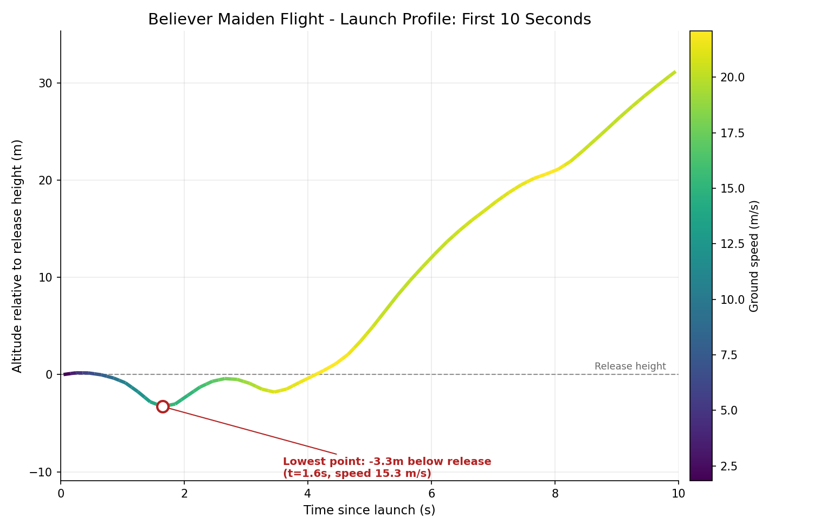
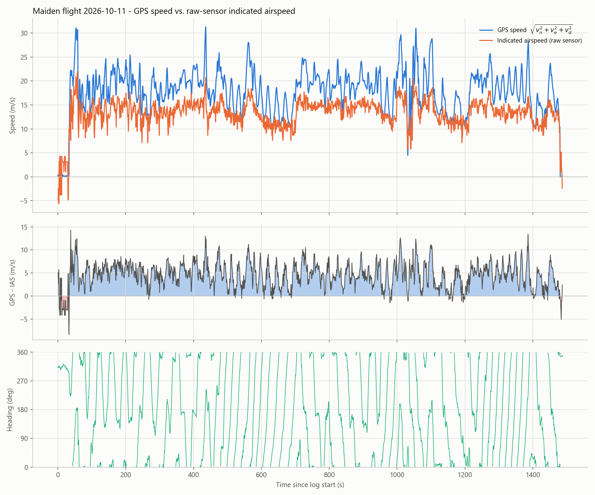
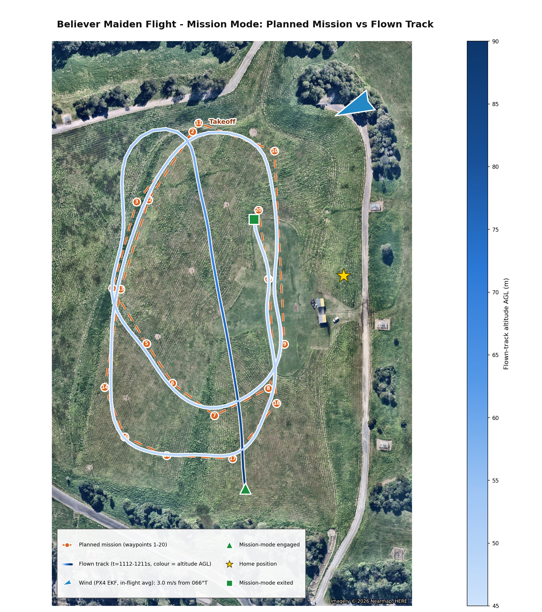
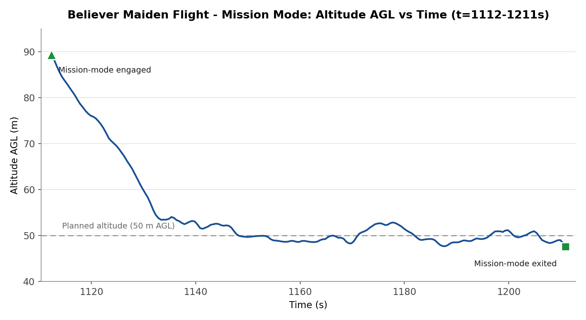

# Test Report - Maiden Flight

| | |
|---|---|
| **Date** | 2026-10-11, approximately 09:02-09:27 Brisbane local time (23:02-23:27 UTC on 2026-10-10 by the aircraft's own clock) |
| **Location** | BNEMAC field, 420 Roghan Rd, Fitzgibbon QLD 4018 |
| **Attendees** | Julian Williams (handler/ground station), Ross Dennington (BNEMAC - pilot), Henry Thomasson (ground support and videographer) |
| **Purpose** | Execute `docs/engineering/test-plans/2026-10-11-maiden-flight-test-plan.md` - first flight of the airframe |
| **Status** | Flown, complete. No crash or structural incident. Analysis traced from the Pixhawk's onboard SD card logs, the launch video, and post-flight debrief (relaying pilot Ross Dennington's account) |

## Summary

The Believer's maiden flight lasted **24 minutes and 47 seconds**, measured from arming to disarming. Takeoff was detected at t = 32.6 s, after which the aircraft completed most of the planned flight-test phases. The first landing attempt was aborted, requiring a go-around, before the aircraft landed successfully and was disarmed at t = 1486.0 s.

The pilot's debrief identified two primary handling concerns:

- **Marginal launch performance:** The aircraft required nearly all the available elevation from the hillside launch site to establish sufficient flying speed following the hand launch (see *Launch*).
- **Difficulty rolling right:** The aircraft exhibited a persistent reluctance to roll right, particularly at higher throttle settings. The pilot suspected that motor torque, resulting from both propellers rotating in the same direction, was opposing the commanded roll.

Both observations are examined against the flight-log data in the sections below.

Additionally, a post-flight inspection identified a defective bearing in the right motor (see *Post-Flight Inspection Findings*).

**The most significant finding concerns the reliability of the ground control station (GCS) telemetry link and its failsafe configuration.** The RFD900x link experienced 18 dropouts during the flight, three of which exceeded the configured 10-second data-link-loss failsafe timeout (`COM_DL_LOSS_T`). On 11 October 2026, `NAV_DLL_ACT` had been deliberately changed from `2` (Return) to `0` (Disabled). This precaution was taken to prevent a loss of GCS connectivity, including a potential laptop failure, from triggering an unintended Return-to-Launch (RTL). Consequently, none of the 18 dropouts triggered an automatic RTL. Had the previous configuration remained active, at least three unintended RTL events would likely have been initiated, despite the pilot maintaining full manual RC control throughout. Further details are provided in *GCS Data-Link Dropouts and the NAV_DLL_ACT Reversal*, with the complete configuration history recorded in `docs/operations/backups/Pixhawk Parameter Backup/parameter-change-log.md`.

**A second significant finding concerns PX4's airspeed validation.** The `airspeed_validated` topic, used by airspeed-dependent flight-control functions, was unreliable for nearly the entire flight, with only 2.9% of samples falling within a physically plausible range. Importantly, this was not a physical sensor or pitot-line fault. The underlying differential-pressure sensor remained healthy and produced physically reasonable measurements throughout the flight. Instead, the PX4 airspeed validator registered a failure 16.4 seconds after takeoff and remained latched in the invalid state, consistent with its default behaviour of preventing in-flight recovery (see *Airspeed Validator Latched Invalid*).

Consequently, flight modes dependent on validated airspeed, including Altitude mode and the hands-off portions of the Cruise Efficiency Sweep, likely operated using degraded or fallback airspeed estimates. To account for this, GPS-derived ground speed was used where a speed reference was required in place of the unreliable validated airspeed output (see *Speed*). For analyses requiring actual airspeed, including *Stall Speed*, *Glide Slope*, and the *GPS-versus-Airspeed Cross-Check*, airspeed was independently reconstructed from the healthy raw differential-pressure measurements.

Finally, the in-flight **PID auto-tuning procedure (Phase D)** was attempted twice. The first attempt was unsuccessful, but the second completed successfully, resulting in updated roll- and pitch-rate controller gains being committed during the flight (see *Findings*).

## Findings

### Flight mode timeline (`vehicle_status.nav_state`, real flight only)

| t (s) | Mode | Likely test-plan phase |
|---|---|---|
| 0.0 | Acro | Armed (GR1 left in the Acro position from a previous check) |
| 32.6 | - | Takeoff detected |
| 89.3 | Position Hold (Loiter) | |
| 93.3 | Manual | Phase A (Airworthiness) |
| 154.5 | Acro | Phase A / H |
| 339.2 | Stabilized | Phase B |
| 426.3-486.1 | Acro / Stabilized / Position Hold, alternating | Phases A/B/H |
| 543.0-699.7 | Stabilized -> Position Hold (569.7-699.7, including the first auto-tune attempt) | Phase D (attempt 1, aborted), I |
| 699.7-947.1 | Stabilized (long segment, 138s) -> Acro -> Stabilized -> Position Hold | Likely includes Phase E (Cruise Sweep), F (Glide), G (Stall) - not separable from `nav_state` alone |
| 995.8-1081.3 | Acro -> Stabilized | |
| 1112.0-1211.1 | **Auto Mission** | Phase K (Mission Mode) |
| 1211.1-1383.4 | Stabilized / Position Hold, alternating, including the second (successful) auto-tune attempt at t=1309.3-1330.2s | Phase D (attempt 2, succeeded) |
| 1482.5 | - | Landing detected |
| 1486.0 | - | Disarmed by RC switch |

**Not observed:** `AUTO_RTL` never appears in this log. Phase J (Return to Home via CH10) does not appear to have been deliberately exercised in flight - the only RTL seen anywhere on the day was the RC-loss-failsafe RTL in the earlier ground/range-check log, which is a different trigger and not a deliberate test of CH10. Flagged in `AI-context/open-items.md`.

**Limitation:** `nav_state` alone cannot distinguish Phase A's Acro launch/landing from Phase H's dedicated Acro check, or isolate Phase E/F/G within the long Stabilized/Manual segments - a full phase-by-phase reconstruction would need the pilot's own recollection of timing, or a closer pass through airspeed/altitude/stick-input traces than this report attempts.

### Launch

Per Julian's debrief: the launch was hand-launched from a hill at the BNEMAC field, and needed all of the elevation the hill afforded to gain enough airspeed to begin climbing - "very touch and go," and it could easily have crashed.

The log backs this up directly. Using the moment altitude first leaves the ground as t=0, the aircraft sagged to **3.3m below release height at t=1.6s**, recovered most of the way, sagged a second, shallower time (~1.8m) around t=3.5s, and only settled into a sustained climb from about t=4s:

The dip coincides with the lowest airspeed of the window - **12.4 m/s at the lowest point**, only 1.4 m/s above `FW_AIRSPD_STALL` (11 m/s). This window is entirely within the time the airspeed validator was still trusting the sensor (see Airspeed validator latched invalid below), so this is EKF-fused airspeed, not a ground-speed proxy - a real, measurably thin margin above stall during the few seconds right after release, not just a visual impression.

The climb-rate figure below (about 1.0 m/s average from takeoff) is consistent with this account - a marginal, not comfortable, margin above stall during the initial climb-out. **Decision (Julian): future flights will use a launch dolly instead of a hand launch** - tracked in `AI-context/open-items.md` and cross-referenced against the existing launch-dolly requirements document (`docs/engineering/requirements/launch-dolly-requirements.md`).

### Altitude and climb

Home position: 24.7m AMSL. Initial climb from takeoff (t=32.6s) reached about 59m AGL by t=89.9s (57.3s), an average climb rate of roughly 1.0 m/s. Maximum altitude reached during the flight was 112.6m AGL (137.3m AMSL), comfortably under the 120m AGL geofence ceiling (`GF_MAX_VER_DIST`). Altitude varied considerably through the flight (roughly 5-86m AGL at the 60-second sample points), consistent with an active flight test campaign working through multiple phases rather than a single cruise segment.

### Speed

GPS ground speed (`vehicle_local_position` vx/vy) ranged from 0 (on the ground) to 31.3 m/s, averaging 17.7 m/s - used here instead of airspeed, since `airspeed_validated` (not the raw sensor, which was healthy throughout - see Airspeed validator latched invalid below) was invalid for almost the whole flight. This is ground speed, not airspeed, and includes wind effects.

### Battery

Pack voltage: 24.97V at arm, 22.99V at disarm (minimum 22.38V in flight), consistent with `BAT1_V_EMPTY` (3.2 V/cell x 6 = 19.2V) never being approached. Reported remaining charge fell from 100% to 74%. Peak current draw was 33.5A, mean 9.4A.

### Airspeed validator latched invalid - not a hardware fault

`airspeed_validated` was invalid for almost the entire flight (only 215 of 7436 samples, 2.9%, in a physically plausible range), and at t=48.9s the `airspeed_selector` logged "Airspeed sensor failure detected. Return to launch (RTL) is advised." This looked at first like a sensor or pitot-line fault, but checking the raw differential-pressure sensor directly (not the processed/validated topic) rules that out: recomputing airspeed straight from the raw pressure readings gives physically sane values (13-24 m/s) for the entire flight, with no negative, zero, or stuck readings - the kind of signature a cut or blocked line would produce. The sensor hardware was working the whole time.

What actually happened: `airspeed_sensor_measurement_valid` flips false exactly once, at **t=49.0s** (16.4s after takeoff), and never recovers for the remaining ~1400s. At that moment body-frame vertical acceleration was swinging up to about 2.4g while indicated airspeed was only 15-17 m/s - not far above the 11 m/s stall speed - during the hard pull-up recovering from the launch sag (see Launch above). That combination is exactly what PX4's `check_load_factor()` validator check is designed to catch (`AirspeedValidator.cpp`), making it the likely trigger. It never got a chance to clear afterward because `ASPD_FS_T_START` was at **-1**, PX4's own default - documented as disabling in-flight re-enabling of the sensor entirely once it's marked invalid.

**Decision: `ASPD_FS_T_START` changed to 2s** so a future transient trip can clear itself in flight instead of latching for the rest of the flight - not yet applied to the physical FC, see `docs/operations/backups/Pixhawk Parameter Backup/parameter-change-log.md`.

This still affects the reliability of any TECS-mediated mode in flight (Altitude mode, hands-off points in Phase E); Phase E's post-flight power-vs-airspeed analysis is not shown for this flight as a result (see What This Does and Does Not Show). Flagged in `AI-context/open-items.md`.

### GPS speed vs. raw-sensor airspeed cross-check

Further confirmation that the airspeed sensor itself was healthy throughout: GPS speed (3D groundspeed magnitude, `vehicle_gps_position` vel_n/vel_e/vel_d - distinct from the Speed section's 2D `vehicle_local_position` figure above, though the two agree closely) and the raw-sensor indicated airspeed track the same overall trend for the whole flight, but GPS speed runs systematically higher - mean difference **+4.53 m/s** (std 2.81).

An [interactive version](../../assets/test-plots/maiden-flight-gps-vs-airspeed-2026-10-11.html) (zoom, hover for exact values) is also saved alongside the static plot.

This offset is wind, not a fault: PX4's own independent wind estimate (`airspeed_wind`, EKF-derived from `windspeed_east`/`windspeed_north`) actively updates throughout the flight (not frozen) and averages **3.88 m/s** - the same ballpark as the observed offset. The two aren't expected to match exactly (GPS speed here is a 3D magnitude including vertical velocity; the wind estimate is purely horizontal, and groundspeed/airspeed/wind is a vector relationship, not one that subtracts cleanly in magnitude), but landing in the same range is reassuring. The heading trace also explains why the wind estimate updates so well here: it shows a consistent repeating full-compass sweep for most of the flight (sustained circular flight, consistent with Hold/Mission loiter at `NAV_LOITER_RAD` = 50m) rather than point-to-point legs - sampling many headings while airspeed and wind stay roughly constant is the condition PX4's wind estimator needs to triangulate the wind vector well.

The near-zero region at the start of the plot (both GPS speed and airspeed close to zero, with some sensor noise) is the handler holding the aircraft stationary before the throw - bounded precisely by the log's own `commander` messages: armed at **t=0.11s**, `Takeoff detected` at **t=32.73s** (matching the Launch section's t=32.6s almost exactly - same event, a different time-zero reference between the two analyses).

### Stall speed (Phase G)

The only extended Manual-mode window in the flight (t=93.3-154.5s, 61.2s - see Flight mode timeline above) contains three separate, clean stall breaks, found by looking for an abrupt nose-down pitch event with the pitch stick essentially neutral (i.e. not pilot-commanded - a genuine aerodynamic break rather than a pushover):

| Event | Peak pitch before break | Stick at break | Raw-sensor IAS at/near break |
|---|---|---|---|
| t≈106.5s | 26.0° nose-up | ≈0.00 (neutral) | 8.15 m/s |
| t≈127.0s | 28.4° nose-up | ≈0.00 (neutral) | 9.95 m/s |
| t≈145.3s | 25.7° nose-up | ≈0.00 (neutral) | 8.66 m/s |

All three follow the same pattern: pitch climbs to 26-28° nose-up, the stick goes to neutral, then pitch breaks downward with no further stick input. This window falls after the airspeed validator had already latched invalid (see below), so these are computed directly from the raw differential-pressure sensor (offset-corrected via `SENS_DPRES_OFF`, standard sea-level density) rather than the validated topic - the raw sensor is confirmed reading correctly throughout the flight, including here.

Three repeated, consistent trials landing in the **8-10 m/s indicated airspeed range**, somewhat below the configured `FW_AIRSPD_STALL` (11 m/s). One caveat: the raw sensor logs at only 1Hz here, so the true instantaneous minimum could be marginally lower than any single sample caught.

Roll angle at the moment of each break (not just over the surrounding window, which also captures repositioning turns before/after) gives a clearer picture: the t≈106.5s and t≈145.3s breaks both happened close to wings-level (roll within about 0-19° at the break itself), with no sign of a roll excursion coincident with the pitch break - no wing-drop signature in the data. The t≈127.0s break happened in a bank that was already smoothly deepening *before* the pitch broke (-22° building to -46° through the break), not a sudden onset at the break itself - a real wing-drop would be expected to show as an abrupt roll-rate change right at the break, not a continuation of a trend already underway beforehand. So none of the three show the signature of an uncommanded wing drop; the banked one reads as a deliberate turning entry rather than a departure, though attitude data alone can't fully substitute for the pilot's own account of how it felt.

### GCS data-link dropouts and the `NAV_DLL_ACT` reversal

18 distinct "Connection to ground station lost" / "GCS connection regained" event pairs were logged. Three exceeded `COM_DL_LOSS_T` (10s):

| Lost at (s) | Regained at (s) | Duration |
|---|---|---|
| 38.8 | 78.6 | 39.8s |
| 97.9 | 114.9 | 17.0s |
| 434.3 | 462.2 | 27.9s |

The remaining 15 dropouts were under 10s (several under 1s). The log's embedded parameter set confirms `NAV_DLL_ACT` was already 0 (Disabled) at boot for this flight - not 2 (Return), as set on 2026-10-02 under RF-06 - and no `AUTO_RTL` transition occurs anywhere in the log. Had RF-06's setting still been live, the three dropouts above would each very likely have triggered an automatic RTL, despite the pilot holding full manual RC control (via ELRS/TELEM1, a separate link from the RFD900x GCS radio) throughout. This directly confirms Julian's reasoning for the reversal ("to stop it RTL if the laptop dies") against real flight data, and is now the documented rationale in `docs/operations/backups/Pixhawk Parameter Backup/parameter-change-log.md`, `docs/operations/manual.md` (Section 6 and step 28), and `docs/engineering/build-checklist.md`.

**Julian's assessment, post-flight: this was the right call.** The GCS laptop actually died before launch on the day, which is what prompted checking this setting in the first place - seeing that happen firsthand made clear how dangerous an un-overridable RTL-on-GCS-loss would be (the pilot has no way to cancel an automatic RTL from the radio once it starts other than switching flight mode again, which assumes the pilot is paying attention and not, say, mid-launch). Combined with the 15+ dropouts actually seen in flight, this is now a settled decision, not just a precaution.

### Investigation of the dropouts' cause

The link was lost for about 148 s of the 1,487 s flight (roughly 10%). The flight log narrows the cause but does not identify it.

| Check | Result |
|---|---|
| Range | The aircraft never exceeded 316 m from home. Dropouts began anywhere from 47 m to 259 m, including the 27.9s outage at 47 m. |
| Signal strength at the aircraft | `radio_status` RSSI stayed at 220 to 254 (254 is the maximum) in the 5s before and during dropouts. |
| Geometry | The lost fraction is 5 to 14% in every bin of bearing to home, elevation angle, distance, bank angle and altitude (bearing and distance measured to the home point, used as a proxy for the GCS position). Correlation of the lost flag with distance, altitude and bank angle is near zero; throttle is the weakest hint (0.14). |
| What the aircraft received | The receive rate from the ground was about 0 B/s during outages, apart from sporadic 21-byte bursts (one heartbeat). |
| What the ground sent | The lost-message counter on the RFD900x port jumped when each long outage ended (by 54, 12 and 52 for the 39.8s, 17.0s and 27.9s outages). The GCS kept transmitting with advancing sequence numbers; the aircraft did not receive them. The GCS software was therefore running throughout. |
| Radio statistics | Remote RSSI, receive errors and corrected errors read 0 in every sample, and the TX buffer reads 0 for 99.98% of samples. The TX buffer has read 0 in every log recorded since 2026-06-02, including clean ones, so these fields carry no information about the dropouts. Mean noise is 25 in this flight against 10 to 14 in every other log, but it does not differ between outage and linked seconds. |
| ELRS link | `input_rc` carries no link-quality data (RSSI fixed at 100, link quality -1), so the ELRS link could not be compared against the dropouts. |
| GCS-side downlink (recovered `.tlog`) | QGroundControl's own session log for the flight (`docs/operations/backups/GCS Telemetry Log Backup/2026-10-11 09-33-15.tlog`) shows the three long outages were not all the same failure. During the 39.8s and 27.9s outages, the aircraft-to-GCS telemetry kept arriving with no gap over 4s - uplink-only failures, confirmed across four independent message types (`HEARTBEAT`, `GLOBAL_POSITION_INT`, `ATTITUDE`, `GPS_RAW_INT`). The 17.0s outage was different: downlink also failed, for about 25s (t=88.1-113.4s - starting roughly 10s before and ending about 1.5s before the aircraft's own reported window), a genuinely symmetric, both-directions loss. |

Range, antenna aspect and bank angle are unlikely causes, and weak signal at the aircraft does not explain a loss that occurs with strong RSSI. The recovered GCS `.tlog` answers the question the flight log alone couldn't: two of the three long outages (39.8s, 27.9s) were uplink-only, with the ground-to-aircraft direction unaffected throughout; the third (17.0s) was symmetric, with both directions down together for longer than the aircraft's own reported window. That one of the three behaves differently from the other two argues against a single uniform cause. Interference from other 900 MHz equipment is one candidate for the symmetric event: the RFD900x hops across 915 to 928 MHz, and both the aircraft's DBR4 receiver and the pilot's GX12 transmitter are dual-band including 900 MHz. This is untested, and the ELRS frequency domain in use has not been checked. A ground-side cause (modem placement, antenna, USB or laptop interference) is equally consistent with the symmetric case.

Data that would settle it: an `ATI5` dump of the air-side RFD900x (only the ground modem's settings are backed up, so the two ends cannot be confirmed to match), and a stationary bench test logging the GCS-lost fraction with the ELRS receiver powered on and off. The GCS `.tlog` has now been recovered and checked (see above), but carries no `RADIO_STATUS` message at all - the ground modem's own RSSI/noise figures, the other half of the Radio statistics row above, aren't recoverable from it.

### PID auto-tune (Phase D)

Two attempts, both visible via `FW_AT_START` and the `fw_autotune_attitude_control` log messages:

- **Attempt 1** (t=669.6s): started, then aborted less than a second later (`FW_AT_START` returned to 0 at t=671.6s) - consistent with the test plan's step 5 (any flight-mode change aborts the tune).
- **Attempt 2** (t=1309.3s): ran for 14.9s and finished successfully at t=1324.2s, committing new gains, confirmed returning to idle at t=1330.2s.

New values (PX4 generic default -> auto-tune result): `FW_RR_P` 0.05 -> 0.1136, `FW_RR_I` 0.10 -> 0.1212, `FW_RR_FF` 0.50 -> 0.6882, `FW_R_TC` 0.40 -> 0.8397, `FW_PR_P` 0.08 -> 0.1120, `FW_PR_I` 0.10 -> 0.1209, `FW_PR_FF` 0.50 -> 0.3225, `FW_P_TC` 0.40 -> 0.4550. Full detail in `docs/operations/backups/Pixhawk Parameter Backup/parameter-change-log.md`. These gains are live as of this flight and were in effect for everything after t=1330.2s (including the Mission-mode segment, which ran earlier at t=1112-1211s, before the successful tune - Mission mode in this flight was flown on the untuned gains).

**Validation - the autotune module's own fit quality:** PX4's autotune publishes its system-identification progress (`autotune_attitude_control_status.fitness`, a residual that should fall to a small value on a confident fit). Roll converged from an initial ~10-16 down to **0.24** at settle; pitch converged similarly to **0.39**. For comparison, the never-executed yaw phase (FW_AT_AXES=3, roll+pitch only - yaw was not tuned) shows clearly nonsensical negative gains in the same topic, which is what a bad/non-converged fit looks like - neither axis that was actually tuned resembles that. PX4's own 4-second post-apply stability check also passed (the gains were not auto-reverted).

**Validation - before/after in the actual flight:** comparing a window right after the new gains applied (t=1330.2-1480.0s) against a comparable earlier segment on the old default gains (t=900.0-1050.0s, similar mix of modes/maneuvering):

| | Pre-tune (defaults) | Post-tune (new gains) |
|---|---|---|
| Roll rate RMS tracking error | 24.8 deg/s | 15.8 deg/s (-36%) |
| Pitch rate RMS tracking error | 15.3 deg/s | 6.9 deg/s (-55%) |

No control surface (`MAIN1`/`MAIN2` V-tail, `MAIN3`/`MAIN5` ailerons) was pegged at its PWM limit anywhere in the post-tune window - if the new gains were too aggressive, saturation or visible ringing would be the first symptom, and neither appears. Taken together, the new gains are a genuine improvement over the untuned defaults, not just a change.

### Mission mode (Phase K)

`navigator` logged "Executing Mission" at t=1112.0s; `nav_state` shows `AUTO_MISSION` from 1112.0s to 1211.1s (99.1s), after which the pilot switched back to Stabilized. No failsafe, geofence breach, or mission-item rejection is recorded during this segment - the mission flew without incident.

**The uploaded mission was replanned at the field and no longer matches the repo's backup.** The real mission (recovered from the Pixhawk's onboard mission storage and cross-checked against the flight's own telemetry to sub-metre precision) has 28 items, not the 32 in `docs/operations/backups/Pixhawk Mission Backup/maiden-mission.plan` (Section 5 of the test plan): item 0 is a camera-mode setup command (no coordinates); item 1 is Takeoff; items 2-20 are 19 waypoints, all at **50m relative altitude** (not 40m as the stale backup has it); items 21-25 are a landing-sequence marker plus speed/camera commands (no coordinates); item 26 is a Loiter-to-Alt descent point 405m from the pattern; item 27 is an actual **Land** item. The old backup's "no landing item" description no longer applies to what's on the aircraft.

The flown track (coloured by altitude AGL) tracks the real mission (orange) closely - mean deviation 17.7m, well within normal fixed-wing turn/overshoot tolerance. The long diagonal leg from the "Mission-mode engaged" marker (bottom) up to the pattern is expected PX4 behaviour, not an anomaly: the aircraft was already airborne and physically near waypoints 15-17 when Mission mode was engaged, and PX4 resumed at waypoint 2 (the first real waypoint after Takeoff) rather than restarting from the ground - so it had to transit across the pattern to reach it first.

That transit leg shows clearly in the altitude trace too: the aircraft was at 89m AGL (well above the planned 50m) when Mission mode engaged, and spent the first ~35s of the segment descending to the pattern's planned altitude before settling into the 48-53m band it holds for the remainder, oscillating gently around the planned 50m rather than tracking it exactly - consistent with normal altitude-hold behaviour through a series of turns rather than any anomaly. The plot's vertical lines mark when each waypoint was actually *accepted* (reached its acceptance radius, per `navigator_mission_item`'s `sequence_current` advancing to the next item) rather than when it first became the active target, so WP2's line sits at the end of that transit/descent, not the start - consistent with Mission mode having engaged near WP15-17 and the aircraft needing to fly there first. Leg timing between acceptances is otherwise fairly even (mostly 3-5s), with two longer legs: WP2 itself (17.97s after engage, the transit leg) and WP10 (12.35s after WP9) - both consistent with longer straight legs in the pattern rather than anything irregular. The aircraft had already reached WP20 and advanced to the next item (26, Loiter-to-Alt) by t=1209.1s, 2s before the pilot switched out of Mission mode - the mission had moved past the planned pattern before the segment ends.

The arrow annotated on the plot is the PX4 EKF's own wind estimate (`airspeed_wind`), vector-averaged over the in-flight period only (takeoff detected to landing detected - ground time before and after excluded, since the estimator isn't meaningfully observing wind while stationary): **2.96 m/s from 066°T**. See the GPS speed vs. raw-sensor airspeed cross-check above for the full method and the caveat that the underlying per-sample estimate wanders in direction over the flight (not a single stationary value) - this is a time-averaged simplification, not an instant-by-instant true wind.

**Independent comparison (regional, not ground truth):** no site anemometer reading exists for this flight. Queried Open-Meteo's historical weather archive (a model/reanalysis dataset, not a station measurement) at the flight's own recorded home position (-27.3365, 153.0362) for 2026-10-11 09:00 local (the flight ran 09:02-09:27) - returned 10m wind of **1.30 m/s from 016°T, gusting to 5.20 m/s**. This is a real discrepancy against the EKF figure, not a confirmation: roughly half the speed and about 50° off in direction. Two things make it a weak comparison rather than a contradiction: the reanalysis grid point is centred about **5.2 km from the actual field**, and its figure is at 10m reference height against the aircraft's 0-112m AGL flight - wind typically increases with height, so some of the gap is expected. The gust figure (5.20 m/s) sits much closer to the EKF's average than the base wind speed does, consistent with the EKF's own direction estimate wandering noticeably over the flight rather than holding steady - genuinely gusty, variable conditions that morning. Hourly resolution is the floor for this data source; no sub-hourly reading was available to check against the 25-minute flight window more precisely. The direction gap is not explained by any of the above and remains open. See `AI-context/open-items.md`.

This is a more significant correction than just altitude, and the repo's mission backup, the test plan's Section 5, and anything else describing the old 32-item/40m mission are now known to be stale. Not yet corrected - flagged in `AI-context/open-items.md` pending a decision on how to regenerate `maiden-mission.plan` from this validated data.

### Go-around and landing

The altitude log confirms a real go-around near the end of the flight: the aircraft descended to a low approach of about **5.6m AGL around t=1443-1445s**, then climbed back out to about 38m AGL by t=1454.1s, before a second, final approach down to landing (`Landing detected` at t=1482.5s, disarmed at t=1486.0s). The aircraft stayed in Stabilized mode (`nav_state`=15) throughout both the low approach and the climb-out - no mode change is recorded across this window, so the go-around was a pilot stick/throttle decision in Stabilized, not a PX4-triggered behaviour. This is a second, independent data point for the pilot's Stabilized-mode recommendation above - the recovery was flown in the mode the pilot found easiest to control.

**Glide slope.** The final approach was a genuine power-off glide, not a powered descent - confirmed two ways: the pilot's throttle stick was pinned at idle (-1.0) and, more conclusively, the actual PWM to both motors (`actuator_outputs`) was 1000us (idle) from t=1463.1s straight through touchdown and after. (A first look at `actuator_motors.control[0]` suggested full throttle here - that was a `NaN` artifact in the analysis script, not real data; the raw PWM is unambiguous.)

Over the glide segment itself (23.4m of altitude lost, 10.7s, 155m of ground track, from idle-throttle at t=1463.1s to touchdown at t≈1473.8s):

| | Value |
|---|---|
| Glide ratio (ground track) | 6.6 : 1 |
| Descent angle | 8.6° |
| Mean sink rate | 2.2 m/s |
| Mean ground speed | 14.6 m/s |

The approach was flown almost directly into a ~3.5 m/s headwind (checked: the ground track heading and the wind-estimate direction are nearly identical), which steepens the ground-track numbers relative to the aircraft's still-air performance. Correcting for it gives an estimated **still-air glide ratio of roughly 8:1** - inferred from ground speed plus the wind estimate, not directly measured, since the airspeed validator was still latched invalid at this point in the flight. For reproducing this specific approach at this field, the as-flown 6.6:1/8.6° figures are more directly useful; for the aircraft's general glide performance, use the ~8:1 estimate.

The descent was not constant-angle: sink rate was shallow initially (0.3-1.2 m/s), steepened through the middle of the approach (up to 4.4 m/s), then eased off in the final 1-2 seconds as the pilot flared before touchdown. A future autoland profile should plan for a distinct flare segment near the ground rather than a single constant glide slope all the way down.

### Roll authority asymmetry (same-direction propellers)

Pilot report: the aircraft struggled to roll right, improving at lower throttle; suspected induced motor torque fighting the roll command, since both propellers turn the same direction (confirmed elsewhere in the project's records - this airframe is not contra-rotating). The pilot flagged they might have the direction confused, so this is checked directly against stick input vs. achieved roll rate below.

**Stick-to-roll-rate sensitivity, Manual/Acro mode** (direct stick-to-surface mapping, not masked by closed-loop rate feedback): for comparable stick deflection magnitude (|stick| > 0.3), positive stick (commands roll right, PX4's standard body-frame sign convention) achieved **32 deg/s of roll rate per unit stick**, while negative stick (roll left) achieved **75 deg/s per unit stick** - more than double the authority in the left direction. This is a large, consistent asymmetry and it matches the pilot's account directly: rolling right takes more stick for less result than rolling left.

**Throttle dependence:** nearly all the positive-stick (right-roll) samples in this flight happened to be at higher throttle (no low-throttle right-roll data exists to compare against), so the specific claim that right rolls get easier at low throttle couldn't be directly checked both ways from this log. A second, independent check - the mean roll-torque the rate controller had to command just to hold wings level in Stabilized/Position Hold (near-zero commanded roll rate, so purely counteracting a disturbance, not executing a turn) - shows a persistent rightward (positive) correction needed through the mid-to-high throttle range, i.e. something is rolling the aircraft left that the controller is constantly fighting, consistent in direction with the stick-sensitivity finding, though the magnitude did not increase cleanly/monotonically with throttle in this slice of data.

**Interpretation:** PX4's control allocation for this airframe assigns zero lateral (`CA_ROTOR0_PY` = `CA_ROTOR1_PY` = 0) offset to both motors, so PX4 itself is not commanding any differential thrust - both motor outputs were commanded identically throughout the entire flight (confirmed: `MAIN4` and `MAIN6` output commands were bit-for-bit identical at every one of 14,871 samples). The asymmetry is therefore not a software/mixing artifact; it is consistent with a genuine airframe effect from both propellers spinning the same direction (equal-and-opposite motor reaction torque on the airframe, additive rather than cancelling since there's no second prop spinning the other way to cancel it) - exactly the mechanism Julian suspected. **Decision (Julian): contra-rotating propellers are needed for the next flight.** Tracked in `AI-context/open-items.md`.

### Stabilized mode, differential thrust, motor balance, and throttle feel

Pilot recommendation, post-flight: take off in Stabilized mode rather than Acro - it flew noticeably nicer. Three follow-up questions were checked against the parameters and the log:

- **Does Stabilized mode use differential thrust for roll?** No - and neither does any other mode on this airframe. The control allocator's rotor geometry (`CA_ROTOR0_PY` = `CA_ROTOR1_PY` = 0, `CA_ROTOR_COUNT` = 2) gives both motors zero lateral moment arm in PX4's model, so roll is 100% aileron in every flight mode; this is a control-allocation-level setting, not something that changes between modes.
- **Are both motors producing equal thrust?** Not verifiable from this log. The two motors received an identical command at every sample (confirmed above), so any thrust imbalance would have to come from the motors/ESCs/propellers themselves, not from PX4 commanding them differently - but with no per-motor current or RPM telemetry fitted, actual thrust output per motor can't be checked in flight. This is an existing open item (per-motor instrumentation); a side-by-side thrust-stand comparison of the two installed motors would be the more immediate option. Worth revisiting now that a bad bearing has also been found in the right motor (see Post-Flight Inspection Findings) - that alone could already be producing unequal thrust.
- **Is the throttle command feedforward/shaped differently in Stabilized mode?** No. Fitting commanded motor output against raw throttle-stick position gives the same linear relationship (slope ≈ 0.50, intercept ≈ 0.50 - i.e. stick mapped straight through, matching `FW_THR_SLEW_MAX` = 0/disabled) in **Manual**, **Acro**, and **Stabilized** modes alike - all three were statistically indistinguishable. (Position Hold/Loiter, by contrast, showed almost no throttle-stick dependence at all, as expected since TECS manages throttle automatically in that mode.) The throttle signal path itself is identical in Stabilized to Manual/Acro, so the "less punchy" feeling the pilot described is not coming from the throttle command - the more likely explanation is that Stabilized mode's attitude control is actively damping out the pitch/roll disturbance that engine thrust changes normally cause (the same disturbance discussed above), which would otherwise be felt directly by the pilot in Manual/Acro as a "punch" but gets corrected away automatically in Stabilized. This is inference from the aircraft's architecture, not something separately measured in this log.

### Takeoff: full throttle needed, but that's also where the induced torque is worst

Per Julian: takeoff requires full throttle to gain airspeed quickly enough to climb away safely, but full throttle is also where the same-direction-propeller torque effect (above) is strongest - a genuine catch-22, and by Julian's account the worst part of the flight. This is consistent with, and reinforces, the contra-rotating-propeller decision above; no separate action beyond that is identified.

### Other anomalies observed

- **Brief critical-failure flag** (`failsafe_flags.fd_critical_failure`, 2 samples true, first at t=574.1s): coincides with a generic "Failsafe activated" log message at the same timestamp, about 2.4s after a switch into Position Hold (t=571.7s) and shortly after a GCS dropout/regain pair (567.4-573.3s). The flight continued normally for another ~900s with no further sign of trouble. PX4's failure detector trips this flag on an excessive attitude/rate excursion - plausibly a stall-recovery or other deliberate maneuver (Phase G/H) rather than a genuine structural event, but not confirmed either way from this log alone.
- **GPS spoofing warning** (t=748.8s): `gps` driver logged "GPS spoofing detected! (state: 2)", a one-off warning. Most likely a false positive (multipath/RF environment at the field) given no corresponding position glitch is evident in the altitude/speed data; not investigated further.
- **MAVLink RADIO_STATUS timeouts**: logged three times (t=580.6s, 949.9s, 1265.2s) - each falls shortly after a dropout ended, not during one, so they do not mark the dropouts themselves.
- **New parameter observed**: `MIS_DIST_1WP` (maximum distance to first waypoint check) was found in this flight's parameter set at 10000m (PX4's firmware default) but was absent from the 2026-10-02 backup export entirely. This looks like an export omission rather than a deliberate change - not acted on further.

## Post-Flight Inspection Findings

Not from the log - found by Julian during post-flight inspection of the airframe:

- **Right motor bearing**: a bad bearing was found in the right motor post-flight. This needs to be rectified before the next flight, and may also be relevant to the motor-balance question above - a degraded bearing is a plausible contributor to an actual thrust/efficiency difference between the two motors, independent of the identical commands PX4 sent them. Tracked in `AI-context/open-items.md`.

## What This Does and Does Not Show

**Shown:** the airframe flew, climbed, and was recovered without incident across a 24.8-minute flight, despite a marginal hill launch; Position Hold, Stabilized, Acro, and Mission modes were all exercised; PID auto-tune completed successfully on its second attempt and measurably improved rate tracking with no saturation; the `NAV_DLL_ACT` reversal is justified by this flight's own GCS link behaviour and by a GCS laptop failure on the day; the uploaded mission flew without rejection or fault; the reported roll-authority asymmetry is real and matches the pilot's account, and is not a control-allocation artifact (no differential thrust is configured on this airframe in any mode); Stabilized mode's throttle path is confirmed identical to Manual/Acro; the airspeed sensor hardware itself was working for the entire flight - the near-total "invalid" readings were a PX4 validator config issue, not a pitot/line fault, further confirmed by the raw-sensor airspeed tracking GPS speed closely with a systematic offset matching PX4's own independent wind estimate; a stall speed of roughly 8-10 m/s IAS from three repeated, clean stall breaks, none showing a wing-drop signature in the attitude data; a measured glide ratio (6.6:1 as flown, ~8:1 estimated still-air) and descent profile from the final power-off approach.

**Not shown:** a reliable Phase E (Cruise Efficiency Sweep) power-vs-airspeed dataset (airspeed validator latched invalid for almost the whole flight); a deliberate Phase J (Return to Home via CH10) test; isolated climb-rate figures broken out by phase (not separable from `nav_state` alone - would benefit from the pilot's own phase timing notes); the pilot's own account of how each stall felt, to corroborate the attitude data's read that none of the three breaks show a wing-drop signature; the cause of the t=574.1s critical-failure flag; root cause of the recurring GCS dropouts (not determinable from this log); confirmation of actual per-motor thrust balance (no per-motor current/RPM telemetry exists, and the right motor's bearing condition at the time of this flight is unknown).

## Outstanding

- Launch dolly: Julian has decided to stop hand-launching and use a launch dolly for future flights - see `docs/engineering/requirements/launch-dolly-requirements.md`.
- Contra-rotating propellers are needed before the next flight - the same-direction setup is the suspected cause of the roll-authority asymmetry and the takeoff-power/induced-torque catch-22, both confirmed against the log.
- Right motor bearing needs replacing/rectifying before the next flight.
- Per-motor thrust balance still cannot be verified in flight (no current/RPM instrumentation per motor) - worth prioritising now that a bearing fault has been found on one side.
- `ASPD_FS_T_START` (decided: -1 -> 2s) needs applying to the physical FC before the next flight - no airspeed sensor hardware inspection is needed, the raw sensor read correctly throughout.
- Phase J (Return to Home, CH10) should be deliberately exercised on a future flight - not yet tested.
- Root cause of the repeated GCS link dropouts (RFD900x) not identified: range, antenna aspect and bank angle are unlikely, but the flight log cannot separate ground-side causes from 900 MHz interference - see "Investigation of the dropouts' cause".
- The t=574.1s `fd_critical_failure` flag and the t=748.8s GPS spoofing warning are noted but not root-caused; revisit if either recurs.
- A frame-by-frame phase breakdown (matching this flight's actual timeline against the test plan's Phases A-K) would benefit from the pilot's own notes on when each phase was flown, since `nav_state` alone cannot separate several of them.
