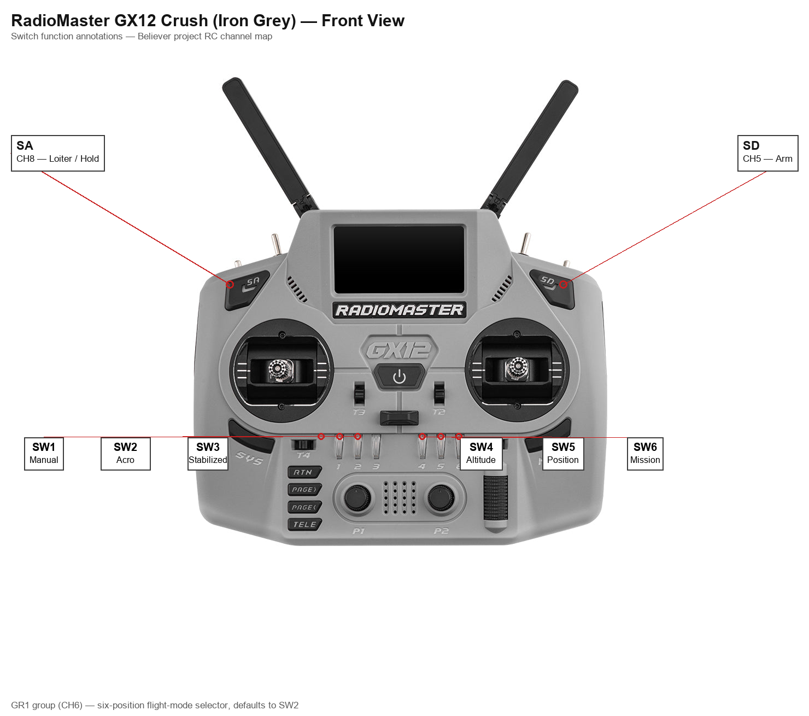
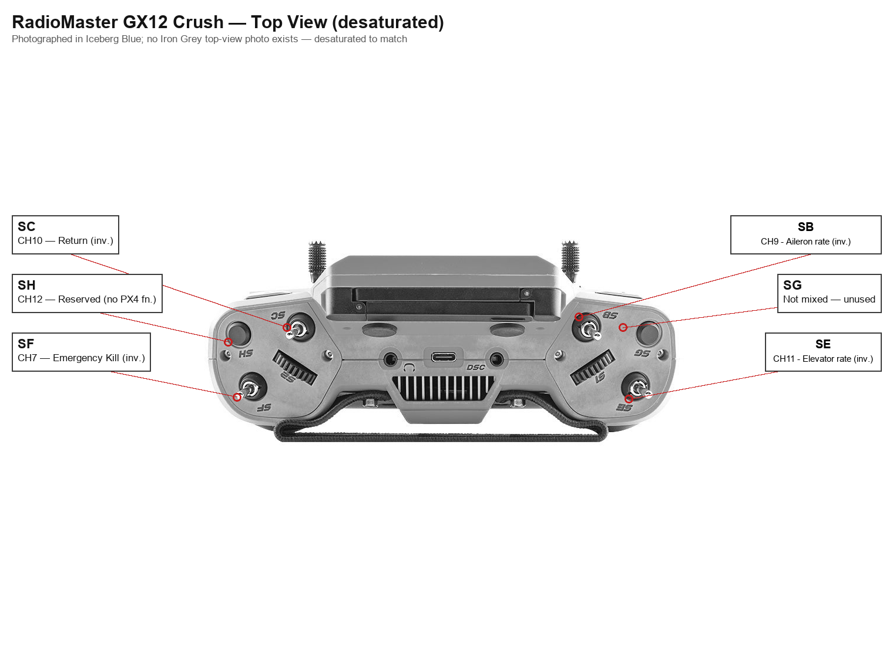
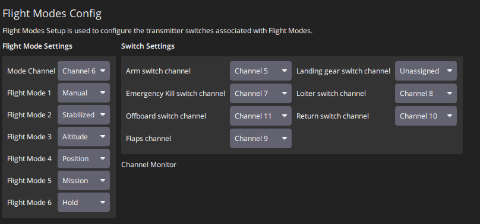

# Believer Flight Manual

| | |
|---|---|
| **Document** | MAN-BELIEVER-001 |
| **Revision** | 1.0 |
| **Date** | 2026-10-12 |
| **Status** | Draft |

Operating manual for the Believer fixed-wing UAV, covering both the pilot-facing quick reference and the full PX4 flight-mode configuration detail. For wiring/pinout/parameter detail, see [ICD.md](../engineering/ICD.md) and `docs/operations/backups/Pixhawk Parameter Backup/parameter-change-log.md`.

## 1. Aircraft Summary

V-tail, twin-motor (left/right) fixed wing, two independently-servoed ailerons. Holybro Pixhawk 6X flight controller running PX4. Centre of Gravity: 15mm aft of the front wing spar carbon rod centerline (~25% MAC).

## 2. RC Control - Channels & Switches

RC link: Radiomaster GX12 transmitter → DBR4 receiver (ExpressLRS, dual-band 2.4GHz/900MHz), Hybrid switch mode with MAVLink enabled.

| Channel | Function | Notes |
|---|---|---|
| CH1 | Roll | Stick |
| CH2 | Pitch | Stick |
| CH3 | Throttle | Stick |
| CH4 | Yaw | Stick |
| CH5 | Arm | Latching button; disarmed at startup |
| CH6 | GR1 flight-mode selector | Six positions; starts on SW2 |
| CH7 | Emergency kill | Inverted in EdgeTX |
| CH8 | Loiter / Hold | Latching button; overrides GR1-selected mode |
| CH9 | Aileron rate switch | Inverted in EdgeTX. SB drives CH9's radio output unchanged, but PX4 no longer acts on it for Flaperon control - `RC_MAP_FLAPS` cleared to 0 (unassigned), 2026-09-02. SB locally selects the aileron tri-rate curve (100/70/50%, CTL-04) in EdgeTX |
| CH10 | Return | Inverted in EdgeTX |
| CH11 | Elevator rate switch | Inverted in EdgeTX. SE drives CH11's radio output unchanged, but PX4 no longer acts on it for Offboard mode - `RC_MAP_OFFB_SW` cleared to 0 (unassigned), 2026-09-02, resolving the dual-purpose overlap previously noted here. SE locally selects the elevator tri-rate curve (100/70/50%, CTL-04) in EdgeTX |
| CH12 | Spare / future buzzer or payload | Currently unassigned |

For channels 7, 9, 10, 11: inversion is handled in EdgeTX already - do not add a duplicate reversal in PX4 unless QGroundControl shows the active/inactive direction is actually wrong.

## 3. Flight Modes (GR1 Switch Group) - Quick Reference

GR1 is a six-button switch group on the GX12 (only one of SW1-SW6 active at a time), mapped to CH6 and used as the main PX4 flight-mode selector.

| GX12 Button | PX4 Mode | Behaviour | Use |
|---|---|---|---|
| SW1 | Manual | Sticks drive the control surfaces directly - no self-levelling | Direct-control backup; avoid for normal launch |
| SW2 | Acro | Sticks command roll/pitch rate directly - no self-levelling, but centring the sticks stops rotation | Startup/default switch position; direct-response flying |
| SW3 | Stabilized | Centring the sticks levels the aircraft; altitude and heading drift freely | Hand-launch mode |
| SW4 | Altitude | As Stabilized, plus altitude is held automatically; heading still drifts | Holds altitude; pilot still flies direction |
| SW5 | Position | As Altitude, plus GPS holds ground track against wind | GPS-assisted track/altitude holding |
| SW6 | Mission | Autonomous; flies a pre-uploaded waypoint mission | Future autonomous missions only |

**GR1 defaults to SW2 (Acro) at startup** - since 2026-08-19 this is no longer Stabilized. Always confirm the active flight mode in QGroundControl and deliberately select Stabilized (SW3) before hand-launch; do not assume the default switch position.

**Hold vs. Loiter:** these are the same PX4 mode - "Hold" is the formal PX4 name, "Loiter" is the older/common name still used in switch labelling. Hold is no longer in the GR1 group (freed 2026-08-19 for Acro, since it duplicated CH8) - it is reachable directly via CH8. When engaged, the Believer flies a circle around the point where Hold was activated while holding altitude - it cannot stop and hover like a multirotor.

CH8 (Loiter/Hold) is a separate switch that overrides whatever mode GR1 has selected and commands Hold directly. CH10 (Return) similarly overrides GR1 and commands the aircraft to climb and fly back to the home position. Offboard mode (hands control to a companion computer) is no longer reachable via any switch as of 2026-09-02 - `RC_MAP_OFFB_SW` was cleared, since SE now serves as the elevator rate switch (CTL-04); Offboard was not in operational use anyway, since the companion computer that would drive it is a future project phase.

For full technical detail on each mode's behaviour and the PX4 parameters that configure it, see Section 5 below.

## 4. Flight Mode Selection and Configuration

PX4 assigns a flight mode to each of up to six switch positions on a single RC channel via the parameters `COM_FLTMODE1` through `COM_FLTMODE6`, configured through QGroundControl's Flight Modes screen (see [PX4: Flight Mode Configuration](https://docs.px4.io/main/en/config/flight_mode.html)). On the Believer, that channel is CH6 (`RC_MAP_FLTMODE` = 6), carrying the GX12's six-position GR1 switch group.

| GR1 Position | `COM_FLTMODEx` | Raw value | PX4 Mode |
|---|---|---|---|
| SW1 | `COM_FLTMODE1` | 0 | Manual |
| SW2 | `COM_FLTMODE2` | 6 | Acro |
| SW3 | `COM_FLTMODE3` | 8 | Stabilized |
| SW4 | `COM_FLTMODE4` | 1 | Altitude |
| SW5 | `COM_FLTMODE5` | 2 | Position |
| SW6 | `COM_FLTMODE6` | 3 | Mission |

Remapped 2026-08-19: Acro was added at SW2 and Hold was dropped from the group (Hold and CH8's Loiter override are the same PX4 mode, so keeping Hold in the GR1 group as well was redundant), shifting Stabilized through Mission down one position each. This matches the switch mapping documented in Section 3 above.

Two further modes are reachable outside the GR1 group, each on its own dedicated switch (see `docs/engineering/ICD.md` RC channel map):

| Channel | Parameter | Mode | Behaviour |
|---|---|---|---|
| CH8 | `RC_MAP_LOITER_SW` = 8 | Hold | Latching; overrides whichever mode GR1 has selected |
| CH10 | `RC_MAP_RETURN_SW` = 10 | Return | Latching; overrides GR1 |

**Offboard is no longer reachable via any switch, as of 2026-09-02.** `RC_MAP_OFFB_SW` was cleared to 0 (unassigned), confirmed via a fresh parameter export - this resolves the SB/SE dual-purpose overlap previously flagged here (flipping elevator rate in flight could no longer trigger Offboard, since PX4 no longer acts on channel 11 for it at all). SE still drives CH11's `mixData` output unchanged in EdgeTX, and separately still selects the elevator tri-rate curve locally (`docs/engineering/build-checklist.md` CTL-04) - only PX4's interpretation of that channel changed, not the radio configuration itself. Not currently used operationally regardless - the companion computer that would drive Offboard is a future project phase. See Section 5.9.

## 5. Flight Mode Technical Detail

### 5.1 Manual

Stick input is sent directly to control allocation with no stabilisation or angle limiting - centring the sticks does not level the aircraft. This is the only PX4 mode that bypasses the flight management unit's normal command path (commands are sent via the safety coprocessor), making it a backup control path if the FMU experiences a firmware-level failure. On the Believer, throttle, aileron, and V-tail (elevator/rudder) surfaces all move directly with stick position - the aircraft will hold whatever attitude the pilot last commanded, including into a stall or a bank, until corrected.

| Parameter | Value | Purpose |
|---|---|---|
| `FW_MAN_P_SC` | 1.0 | Pitch stick-to-surface scale factor |
| `FW_MAN_R_SC` | 1.0 | Roll stick-to-surface scale factor |
| `FW_MAN_Y_SC` | 1.0 | Yaw stick-to-surface scale factor |

These three parameters scale stick-to-actuator commands **specifically in full Manual mode** - they have no effect in Acro or Stabilized, which command angular rate or attitude respectively rather than sending stick input directly to control allocation. None have been adjusted; all remain at the PX4 default of 1.0 pending `docs/engineering/build-checklist.md` CTL-08 (reopened 2026-09-02, formal Manual-mode test procedure still to be run).

**Bench behaviour in Acro or Stabilized is not evidence about these parameters.** Apparent early control-surface saturation was observed on the bench and initially suspected to be a `FW_MAN_*_SC` scaling fault. An informal bench comparison narrowed it to Acro mode specifically - consistent with the hypothesis that its rate controller integrates against a persistent, unclosing error on a stationary airframe that can never achieve the commanded rate (integral windup), driving a surface to its endpoint well before the stick reaches full travel - but this has not yet been confirmed via CTL-08's formal, logged Manual-mode test. A direct, proportional stick-to-surface relationship should only be expected in full Manual mode.

Used during ground functional checks (Section 8, step 32-33) and as the emergency direct-control fallback. Not used for launch.

### 5.2 Acro

Stick input commands angular rate (roll/pitch rate, and yaw rate if enabled) rather than attitude - centring the sticks holds the current rotation rate (zero, if already stopped), but does not level the aircraft the way Stabilized does. Added to the GR1 group 2026-08-19 to give direct, high-rate stick response without an attitude limit - this is the behaviour the team originally expected from Stabilized mode (Section 5.3); Acro is PX4's mode for it.

| Parameter | Value | Purpose |
|---|---|---|
| `FW_ACRO_X_MAX` | 90 deg/s | Maximum commanded roll rate |
| `FW_ACRO_Y_MAX` | 90 deg/s | Maximum commanded pitch rate |
| `FW_ACRO_Z_MAX` | 45 deg/s | Maximum commanded yaw rate |
| `FW_ACRO_YAW_EN` | 0 (Disabled) | Yaw axis is not rate-controlled in Acro - yaw stick maps directly to the yaw actuator output, as in Manual |

Reachable via GR1 SW2. Values shown are PX4 generic fixed-wing defaults, not yet deliberately tuned for the Believer (CTL-02, `docs/engineering/build-checklist.md`).

### 5.3 Stabilized

Centring the roll/pitch sticks levels the aircraft's attitude and holds it there; altitude and heading are **not** held and will drift with throttle setting and wind. Roll and pitch are angle-controlled (bounded by `FW_MAN_R_MAX`/`FW_MAN_P_MAX`), so the aircraft cannot be looped or rolled inverted from the stick. Throttle is direct - at zero throttle the aircraft glides. Yaw stick adds manual yaw beyond the autopilot's own turn-coordination.

| Parameter | Value | Purpose |
|---|---|---|
| `FW_MAN_R_MAX` | 45 deg | Maximum commanded roll angle |
| `FW_MAN_P_MAX` | 30 deg | Maximum commanded pitch angle |
| `FW_MAN_YR_MAX` | 30 deg/s | Maximum manual yaw rate |
| `FW_PSP_OFF` | 0 deg | Pitch angle offset for level flight |

This is the mode used for hand-launch (Section 9, Assisted Hand Launch), reachable via GR1 SW3. On the V-tail airframe, pitch and yaw commands are both output through the V-tail servos (MAIN 1/2, `docs/engineering/ICD.md` INT-02a/INT-02b) via PX4's ruddervator mixing rather than separate elevator and rudder surfaces.

No yaw authority was observed in Stabilized mode during the 2026-07-10 TMAC session (CTL-01, `docs/engineering/build-checklist.md`). This has been resolved: the expected direct yaw-stick response is properly Acro mode's behaviour (Section 5.2), not Stabilized's, and Acro has been added to the GR1 group to provide it. The V-tail yaw mixing gain (`CA_SV_CS2_TRQ_Y`/`CA_SV_CS3_TRQ_Y`, `docs/engineering/ICD.md` Control Surface Mixing) was also raised from 0.50 to 0.85 as part of finalising the 2026-07-10 TMAC trim values. **Note (2026-08-31):** a subsequent control-allocation review found this ±0.85 pair was not a validated rudder-mix ratio, and the target is to restore it to the PX4 type-default ±0.50 - the live value remains ±0.85 as of this writing, pending `docs/engineering/build-checklist.md` CTL-06.

Turn coordination in this and the automatic modes below is governed in part by `FW_RLL_TO_YAW_FF` (roll-to-yaw feedforward gain, currently 0.0 - the PX4 default), which counteracts adverse yaw on roll entry. It remains at 0.0 in the baseline configuration; any change is deferred until flight testing demonstrates meaningful adverse yaw (`docs/engineering/build-checklist.md` CTL-07) - no non-zero value is currently planned or decided.

### 5.4 Altitude

As Stabilized, plus the autopilot actively holds altitude and airspeed when the sticks are centred - heading still drifts with wind, since there is no position source used for course correction. Pitch stick commands climb/descent rate; throttle stick at centre (50%) holds the current altitude at the trimmed cruise airspeed; roll stick commands bank angle with automatic turn coordination.

| Parameter | Value | Purpose |
|---|---|---|
| `FW_AIRSPD_TRIM` | 20 m/s | Cruise airspeed target |
| `FW_AIRSPD_MIN` | 15 m/s | Minimum controlled airspeed |
| `FW_AIRSPD_MAX` | 28 m/s | Maximum controlled airspeed |
| `FW_AIRSPD_STALL` | 11 m/s | Stall speed used by low-speed protection |
| `FW_T_CLMB_R_SP` | 3 m/s | Commanded climb rate at full pitch-up stick |
| `FW_T_SINK_R_SP` | 2 m/s | Commanded sink rate at full pitch-down stick |
| `FW_T_CLMB_MAX` / `FW_T_SINK_MAX` | 5 m/s | Climb/sink rate limits |
| `FW_MAN_R_MAX` | 45 deg | Maximum commanded roll angle (shared with Stabilized) |

Requires an altitude source (barometer, always available) but not GPS.

Updated 2026-09-02 (`docs/engineering/build-checklist.md` CTL-10), informed by Weishäupl et al. 2024's measured data for what is very likely the same commercial airframe: `FW_AIRSPD_STALL` set to the paper's measured 1g stall speed (11 m/s, up from the untuned PX4 generic default of 7 m/s); `FW_AIRSPD_MIN` raised to keep real margin above it; `FW_AIRSPD_TRIM` set to 20 m/s, matching both the manufacturer's recommended cruise speed and the paper's figure; `FW_AIRSPD_MAX` raised to 28 m/s, giving margin below the paper's measured VNE (37 m/s, flutter-limited) while comfortably exceeding the new trim speed. The maiden flight's own measured stall speed (8-10 m/s) came in lower than this configured value - see `AI-context/open-items.md` for the decision not to retune it yet.

### 5.5 Position

As Altitude, plus the autopilot also holds ground track against wind - releasing the sticks returns the aircraft to straight, level flight on its current course and altitude regardless of wind. Requires a valid global position estimate (GPS). Uses the same airspeed and climb/sink parameters as Altitude mode (Section 5.4).

Requires GPS 1 (M8N, `docs/engineering/ICD.md` INT-05) lock; GPS 2 (RTK) is not required for Position mode to function.

### 5.6 Hold

Automatic mode - RC stick input is ignored. The aircraft loiters in a circle around the GPS position and altitude at which Hold was engaged. Requires a global position estimate (GPS); if disarmed, the vehicle cannot arm without a position lock.

| Parameter | Value | Purpose |
|---|---|---|
| `NAV_LOITER_RAD` | 50 m | Loiter circle radius. Tightened from 80 m, NAV-08, 2026-10-02 - checked against bank-angle/stall-margin limits (see `docs/operations/backups/Pixhawk Parameter Backup/parameter-change-log.md`) |
| `NAV_MIN_LTR_ALT` | 40 m (provisional) | Minimum loiter altitude, above the home position, not AMSL/AGL (confirmed against PX4's parameter description). Changed from -1 (disabled), NAV-08, 2026-10-02 - requires a pre-flight site survey confirming no obstacle in the flight test area exceeds this height (Section 8, step 5) |

On the Believer, "Hold" and "Loiter" refer to the same mode - see Section 3 above for the naming note. No longer in the GR1 group as of 2026-08-19 (freed for Acro, Section 5.2); reachable directly via CH8 (which overrides GR1). Used as an emergency safe-hold and as the RC-loss failsafe action for a lost data link (Section 6).

### 5.7 Mission

Automatic mode - executes a pre-uploaded flight plan waypoint-by-waypoint. Requires a global position estimate (GPS), the vehicle to be armed, and a valid mission to be uploaded; if no mission exists or the mission completes, the aircraft loiters (Hold behaviour) instead. A mission can be paused by switching to Hold or Position and resumed from the same waypoint.

| Parameter | Value | Purpose |
|---|---|---|
| `MIS_TKO_LAND_REQ` | 2 | Requires the mission to contain a landing pattern (PX4's fixed-wing default) - see [PX4: Mission Mode](https://docs.px4.io/main/en/flight_modes_fw/mission.html). The maiden mission (below) has no landing pattern; `RTL_TYPE` was changed to 0 (Section 5.8) specifically so this requirement isn't enforced against it |
| `NAV_LOITER_RAD` | 50 m | Loiter radius used at mission completion or a loiter waypoint (shared with Hold). Tightened from 80 m, NAV-08, 2026-10-02 |

Reachable via GR1 SW6. A maiden-flight test mission is uploaded (`docs/operations/backups/Pixhawk Mission Backup/maiden-mission.plan`, added 2026-10-02): one takeoff item followed by 31 waypoints, all at 40 m relative altitude, forming a closed pattern entirely inside the uploaded polygon geofence (Section 6). If engaged while already airborne (the only way this mission will be flown), PX4 treats the takeoff item as a normal waypoint rather than attempting an autonomous takeoff. The mission has no landing item, RTL item, or loiter-unlimited item - on completing the last waypoint, the aircraft automatically enters Hold behaviour at that position and altitude (`NAV_LOITER_RAD`, above), and remains there until the pilot switches modes. Automatic takeoff and landing more generally are tracked as future capability work in `docs/governance/timeline-and-roadmap.md`, consistent with `RTL_LAND_DELAY` below currently disabling auto-land.

### 5.8 Return

Automatic mode - pilot input is ignored. The aircraft climbs to a safe altitude, transits directly to the home position (no rally points are defined, and `RTL_TYPE` no longer considers a mission landing pattern - see below), and then either loiters or lands depending on configuration.

| Parameter | Value | Purpose |
|---|---|---|
| `RTL_RETURN_ALT` | 100 m | Altitude held during the return transit |
| `RTL_DESCEND_ALT` | 100 m | Altitude at which the aircraft transitions from transit to loiter/landing behaviour |
| `RTL_LOITER_RAD` | 50 m | Loiter radius at the return destination. Tightened from 80 m, NAV-08, 2026-10-02 |
| `RTL_LAND_DELAY` | -1 | Aircraft loiters indefinitely at the destination rather than landing automatically (auto-land is not yet configured - see `docs/governance/timeline-and-roadmap.md`) |
| `RTL_TYPE` | 0 | Direct to home or the closest rally point, never a mission landing pattern - see [PX4: Return Mode](https://docs.px4.io/main/en/flight_modes_fw/return.html). Changed from 1 (Mission landing/rally point return), 2026-10-02, because the maiden mission has no landing pattern - `RTL_TYPE` = 1 would likely have caused PX4 to reject it ("landing pattern required"). Behaviourally equivalent to 1 for this mission/field (no rally points or landing pattern exist either way, so 1 would have fallen back to home anyway) |

`RTL_RETURN_ALT` and `RTL_DESCEND_ALT` are both set to 100m, comfortably inside the 120m AGL geofence ceiling (`GF_MAX_VER_DIST`, see `docs/operations/backups/Pixhawk Parameter Backup/parameter-change-log.md`). Reachable via CH10 (overrides GR1), and is also the aircraft's configured RC-loss failsafe action (Section 6).

### 5.9 Offboard

Automatic mode - the aircraft obeys position, velocity, attitude, or actuator setpoints streamed continuously by an external system (e.g. a companion computer) via MAVLink or ROS 2, rather than any onboard autonomous logic. PX4 requires this setpoint stream to already be running as a "proof of life" before the vehicle can arm into or switch into Offboard; if the stream stops for longer than `COM_OF_LOSS_T`, the offboard-loss failsafe action is triggered.

| Parameter | Value | Purpose |
|---|---|---|
| `COM_OF_LOSS_T` | 1.0 s | Timeout before the offboard-loss failsafe triggers |
| `COM_OBL_RC_ACT` | 0 | Failsafe action taken on offboard loss - see [PX4: Offboard Mode](https://docs.px4.io/main/en/flight_modes/offboard.html) |

**No longer reachable via any switch, as of 2026-09-02** - `RC_MAP_OFFB_SW` was cleared to 0 (unassigned), confirmed via a fresh parameter export, resolving the dual-purpose overlap against the elevator rate switch previously flagged here (see Section 4). SE still drives CH11's `mixData` output unchanged in EdgeTX and separately still selects the elevator tri-rate curve locally (CTL-04) - only PX4's interpretation of the channel changed. Not currently used operationally regardless - the companion computer that would drive it is a future project phase (`docs/governance/timeline-and-roadmap.md`) - a new switch assignment (via `RC_MAP_OFFB_SW`) can be made whenever that phase begins.

## 6. Failsafe Interactions

Two of the three failsafe conditions that can force the aircraft into a flight mode independently of the GR1/CH8/CH10 switches are configured to take automatic action; the third (data-link loss) is deliberately disabled:

| Failsafe | Parameter | Value | Action |
|---|---|---|---|
| RC (control) link loss | `NAV_RCL_ACT` | 2 | Return - unchanged, PWR-04/RF-06 |
| Data link (telemetry/GCS) loss | `NAV_DLL_ACT` | 0 | Disabled - briefly changed to 2 (Return) on 2026-10-02 (RF-06), then reverted to 0 on 2026-10-11 before the maiden flight. The maiden flight log shows why: the RFD900x GCS link dropped out at least 15 times over 24.8 minutes, three exceeding `COM_DL_LOSS_T`'s 10s timeout - with this at 2, each would have triggered an unwanted RTL despite the pilot having full manual RC control throughout. See `docs/operations/backups/Pixhawk Parameter Backup/parameter-change-log.md` and `docs/engineering/test-reports/2026-10-11-maiden-flight.md` |
| Low battery | `COM_LOW_BAT_ACT` | 3 | Return at critical level (`BAT_CRIT_THR`), Land at emergency level (`BAT_EMERGEN_THR`) - changed from 0 (Warning only, PX4's default), PWR-04 |

See [PX4: Safety Configuration](https://docs.px4.io/main/en/config/safety.html) for the full failsafe action enum. Battery failsafe thresholds (`BAT_LOW_THR`, `BAT_CRIT_THR`) and geofence breach action (`GF_ACTION`) are documented in `docs/operations/backups/Pixhawk Parameter Backup/parameter-change-log.md`.

## 7. Pre-Flight Safety State

Intended safe startup condition, to be verified before every flight:

| Channel | State |
|---|---|
| CH5 (Arm) | Disarmed |
| CH6 (Flight mode) | SW3 selected: Stabilized |
| CH7 (Kill) | Inactive |
| CH8 (Loiter) | Inactive |
| CH9 (Aileron rate) | TBD - confirm intended default/starting rate position |
| CH10 (Return) | Inactive |
| CH11 (Elevator rate) | TBD - confirm intended default/starting rate position |

## 8. Pre-Flight Checklist

### Site and conditions

1. Check the weather forecast. Confirm wind speed, gusts, and visibility are within acceptable limits for the planned flight.
2. Check NOTAMs and confirm the operating area and altitude are clear of airspace restrictions.
3. Confirm the pilot is briefed on and understands the function of every switch and gimbal control (if fitted) relevant to the flight modes planned for this flight, per the current flight test plan.
4. Confirm the pilot and handler agree that flight mode changes and arm/disarm status will be called out verbally from both the radio side and QGroundControl throughout the flight.
5. Confirm no obstacle (tree, pole, structure) in the flight test area exceeds `NAV_MIN_LTR_ALT` in height (40 m provisional - see NAV-08), per the current flight test plan's site survey.

### Assembly and inspection

6. Remove airframe components from the carry box and inspect for damage incurred in transport.
7. Assemble the airframe, ensuring all connections are firmly engaged.
8. Reinspect the assembled airframe for damage.
9. Confirm the motor/ESC inspection-bay covers are secured on both sides.
10. Confirm the nacelle fairings are secured.
11. Inspect the pitot tube. Confirm the tube is unobstructed (no insects, moisture, or transport tape covering the inlet) and the tubing to the airspeed sensor is securely connected.
12. Install the 900 MHz antennas to the external antenna ports; ensure they are correctly torqued and oriented to prevent damage.
13. Confirm the DBR4 receiver's antennas are correctly oriented and securely mounted.
14. Install the M8N GPS in its mount and torque to secure.
15. Connect the M8N GPS to the GPS 1 port on the Pixhawk flight computer.

### Power on and ground station

16. Power on the GX12 transmitter and confirm the throttle is at the minimum position and the kill switch is engaged.
17. Install the battery, secure it with the retention strap, and confirm the velcro on the underside of the battery is engaged. Verify the centre of gravity is correct. Do not connect the battery to the power distribution board at this stage.
18. Connect the RFD900 ground station module to a laptop running QGroundControl.
19. Connect the battery to the power distribution board and establish a connection with QGroundControl.
20. Confirm the GX12 transmitter's audio volume and QGroundControl's audio alert volume are both turned up and audible.
21. Perform any flight computer calibration steps required.
22. Update `SENS_BARO_QNH` to the current ambient barometric pressure reading.
23. Confirm QGroundControl reports no warnings, and that the `COM_DISARM_LAND` parameter reads -1 (auto-disarm on landing is disabled for the maiden flight - see step 51).
24. Confirm `COM_LOW_BAT_ACT` reads 3 (Return at critical battery, Land at emergency battery).
25. Confirm the battery parameters match the battery chemistry actually installed (currently the custom 6S4P Li-ion pack: `BAT1_V_EMPTY` = 3.2 V/cell, `BAT1_V_CHARGED` = 4.05 V/cell, `BAT1_N_CELLS` = 6). If a different pack (e.g. a LiPo) is ever fitted instead, these must be updated to match its chemistry - otherwise PX4 estimates remaining charge against the wrong discharge curve and can silently report far more charge than actually remains.
26. Confirm sufficient battery capacity remains for the planned flight.
27. Confirm the home position is set correctly in QGroundControl. This is the point the aircraft will return to on an RTL or failsafe event.
28. Confirm `NAV_RCL_ACT` reads 2 (RC loss triggers Return) and `NAV_DLL_ACT` reads 0 (data-link/GCS loss is deliberately disabled, not Return - reverted 2026-10-11 after the maiden flight's GCS link dropped out repeatedly in normal conditions; see `docs/operations/backups/Pixhawk Parameter Backup/parameter-change-log.md`), and that `RTL_TYPE` reads 0 and `RTL_LAND_DELAY` reads -1 (Return goes directly to the home position confirmed in the previous step and holds there rather than landing automatically).
29. Confirm `NAV_LOITER_RAD` and `RTL_LOITER_RAD` both read 50 m, and that `NAV_MIN_LTR_ALT` reads 40 m (see NAV-08 and step 5).
30. Confirm the geofence is loaded and active in QGroundControl: `GF_ACTION` reads 3 (Return), `GF_MAX_VER_DIST` reads 120 m, and the polygon fence matching the current flight site's actual boundary is shown active on the map (`GF_MAX_HOR_DIST` intentionally stays 0/disabled - horizontal containment is provided by the polygon instead, not a numeric radius).
31. Confirm RC link signal quality (RSSI) is good in QGroundControl before proceeding.

### Ground functional checks (propellers removed)

32. With propellers removed, arm the vehicle in Manual mode.
33. Confirm all flight control surfaces are correctly trimmed and respond appropriately to control inputs in **Manual mode**: verify correct direction of movement, and that each surface reaches its intended safe travel limit at or near full stick, without binding.
34. Switch to Stabilized mode and confirm all flight control surfaces move in the correct direction in response to changes in aircraft attitude. Full, independent surface travel is not expected here; V-tail surfaces may show safe saturation under large combined pitch+yaw attitude changes without indicating a fault.
35. Confirm the motors rotate in the correct direction.
36. Confirm the aircraft can be switched into all flight modes via the GR1 selector (see [assets/gx12-front-switches.png](../assets/diagrams/gx12-front-switches.png) and [assets/gx12-top-switches.png](../assets/diagrams/gx12-top-switches.png)), and that each mode change is mirrored correctly in QGroundControl (see [assets/flight-modes-config.png](../assets/config-screenshots/flight-modes-config.png)).
37. Confirm QGroundControl reacts appropriately to changes in aircraft attitude.
38. Blow gently on the pitot tube inlet and confirm QGroundControl shows a non-zero airspeed reading. Release and confirm the reading returns to zero.
39. Disarm the vehicle before proceeding.

### Pre-launch

40. Install and torque the propellers.
41. Confirm propeller retention nuts are correctly torqued on both motors.
42. Confirm GPS has acquired a 3D fix with an appropriate number of satellites and HDOP before arming for flight.

### Assisted hand launch

Two people are required: a **pilot** operating the GX12 and a **handler** who holds and throws the aircraft. The handler must not approach the aircraft until the pilot signals ready.

43. Confirm the launch area and airspace overhead are clear of people, animals, obstructions, and other aircraft.
44. Pilot: select the launch mode specified in the current flight test plan (normally Stabilized, GR1 SW3 - see Section 3), calling out the mode change, and confirm throttle is at minimum.
45. Handler: hold the aircraft at shoulder height with the nose pointing directly into wind. Grip the fuselage firmly at the centre of gravity. Keep all fingers and hands well clear of both propeller arcs.
46. Pilot: arm the aircraft (CH5), calling out "armed" once confirmed in QGroundControl, and advance throttle to approximately 75-100%.
47. Pilot: call "launch" (or pre-agreed signal).
48. Handler: throw the aircraft firmly forward and level into the wind, releasing cleanly. Step clear immediately after release.
49. Pilot: hold the launch mode and allow the aircraft to accelerate and establish a positive climb rate before commanding a steep climb. Do not pull hard back on the stick immediately after release.
50. Climb to a safe altitude and confirm wings-level flight before switching modes or adjusting course.

### Landing and shutdown

`COM_DISARM_LAND` is -1 for the maiden flight, so the aircraft does not disarm itself after landing and remains armed until it is disarmed manually.

51. Pilot: once the aircraft has landed and stopped, set throttle to minimum and disarm with the arm switch (CH5). Confirm QGroundControl shows Disarmed and call out "disarmed". If the motors start or a propeller turns unexpectedly, use the emergency kill switch (CH7).
52. Handler: do not approach the aircraft until the pilot confirms it is disarmed. Keep clear of both propeller arcs.
53. Disconnect the flight battery.

See also [build-checklist.md](../engineering/build-checklist.md) for the build, retention, and configuration checklist.

## 9. Open Items

- None of the Acro rate limits (Section 5.2), airspeed, roll/pitch limit, or TECS climb/sink parameters in Sections 5.4-5.5 have been deliberately tuned for the Believer yet (CTL-02, `docs/engineering/build-checklist.md`) - values shown are the as-exported PX4 generic fixed-wing airframe defaults.

## 10. Revision History

| Rev | Date | Description |
|---|---|---|
| 1.0 | 2026-10-12 | Merged `docs/engineering/flight-modes.md` into this document as Sections 4-6 (Flight Mode Selection, per-mode technical detail, Failsafe Interactions) and Section 9 (Open Items), per Julian's repo restructure - the two documents covered overlapping ground (pilot quick-reference vs. PX4 configuration detail for the same flight modes) and are now one. `flight-modes.md`'s own prior revision history (1.0-1.17, 2026-07-17 to 2026-10-11) is preserved in `AI-context/CHANGELOG.md` and git history, not duplicated here. Path references updated for the same restructure (`docs/project/` -> `docs/governance/`, backup folders moved under `docs/operations/backups/`) |
